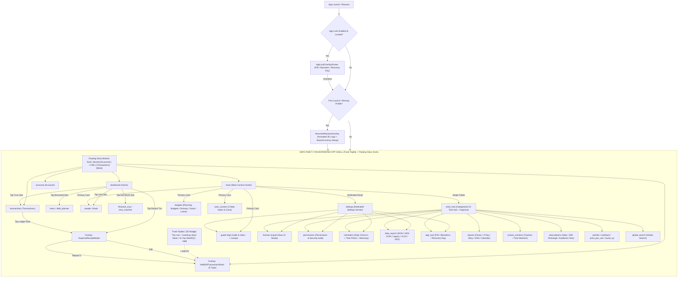

# TRACMIO COMPLETE UI/UX RESTORATION & FEATURE ARCHITECTURE MASTER SPECIFICATION

**Document Version:** Phase 1 Master Audit & Architecture Specification (`1.0`)  
**Target Release Identity:** `com.tracmio.app` · `versionCode = 30` · `versionName = "16.13"` (`Tracmio-16.13.apk`)  
**Visual/Interaction Design Reference:** Tracmio Version 2.5 HTML Prototype (`Tracmio___Personal_Finance___Budget_Tracker___v1.00__6__2d08f923.html` / attached HTML) + Dashboard Reference Screenshot (`file_0000000030648211a59e9e3bf237cf68_d17ce2ee.png`)  
**Functional & Security Backend Source:** Tracmio Version 16.13 Android Kotlin/Compose Repository (`app/src/main/java/com/tracmio/app/...`)

> **Evidence Tag Legend Used Throughout This Specification**
> - `[VERIFIED IN VERSION 2.5]` — Directly observed in the Version 2.5 HTML CSS/DOM/JS reference or Dashboard PNG screenshot.
> - `[VERIFIED IN VERSION 1.16.13]` — Directly verified in Kotlin, Room, Manifest, Gradle, or Robolectric source files.
> - `[INFERRED]` — Logically derived from matching tokens, comments, or sibling components across HTML and Kotlin where direct runtime inspection is absent.
> - `[PROPOSED]` — Recommended UX/architectural synthesis to bridge Version 2.5 layout with Version 16.13 features cleanly.
> - `[NOT VERIFIED]` — Cannot be verified because the compiled Version 2.5 `.apk` binary is not present on disk and Android Emulator/ADB runtime is unavailable.
> - `[MISSING]` — Feature, screen, or UI control exists in one reference source (HTML or PRD) or state store, but is absent or unwired in the current Version 16.13 Kotlin UI.

---

## 1. Project Overview

Tracmio is a **100% offline-first, zero-network Android personal finance, ledger, budgeting, and wealth-intelligence application**. This specification defines the authoritative blueprint for **Phase 2 Restoration**: combining the complete **Version 2.5** Aurora Teal Liquid Glass visual and motion experience with the complete **Version 16.13** offline financial engine, SQLCipher vault, and Android notification/export bridges.

### Core Mandate
1. **Strict Visual Responsibility (Version 2.5):** Preserve the Aurora Teal Liquid Glass design language, dual-tone italic `Trac`mio wordmark with leaf-accented `ı`, fixed zero-search topbar with triple-tap stealth Privacy Eye, Aurora Wave hero card, Monthly Pace meter with white vertical target needle, 2×2 Quick Stats tiles (`Borrowed`, `Lent`, `Net Worth`, `Transactions`), raised mint-cyan center `+` floating glass dock, 3D glass icon badges, bottom-sheet drag-to-dismiss physics, WebGL/mesh parallax backdrop, and all 10 selectable page animation styles.
2. **Strict Functional Responsibility (Version 16.13):** Preserve 100% of existing offline financial logic (`MoneyPaise`, `FinancialCalculator`, `NativeLedgerCalculator`, `NativeIntelligenceCalculators`), all **19 Room v10 entities**, fail-closed **SQLCipher + Android Keystore** security, **App Lock** (PBKDF2 120k + BiometricPrompt + One-Time Recovery Key), **AES-256-GCM** encrypted JSON backups, Legacy migration wizard, **PDF / XLSX / CSV** exports, **3-Step Cash Counter**, and offline `AlarmManager` receivers with zero network permissions (`INTERNET` and `ACCESS_NETWORK_STATE` omitted).
3. **Confirmed Phase 1 User Decisions (Highest Precedence):**
   - **Missing v2.5 APK Resolution:** Because no Version 2.5 `.apk` binary exists on disk, the Version 2.5 HTML specification + Dashboard PNG serve as the authoritative visual source; any native Android-only APK behavior not visible in HTML/PNG is marked `[NOT VERIFIED]`.
   - **Typography Direction:** Align to the **HTML font specification** (`'Inter', 'Plus Jakarta Sans'` for brand/display and `'Nunito'` for body copy, paired with `JetBrains Mono` for tabular ledger numerals where bundled).
   - **More Page & Tools Organization:** Standardize on **Single Tools Hub folder + dedicated Settings screen** (removing the duplicate inline 24-tool grid currently rendered directly inside `MoreScreen`).
   - **Bottom Navigation Bar:** Standardize on the **HTML 5-slot floating glass dock** (`Home`, `Accounts`, raised glowing center `+`, `Transactions`, `More`).

---

## 2. Source Files and Version Analysis

| Artifact / Layer | Identifier / Location | Verified Scope & Role | Audit Limitations |
|---|---|---|---|
| **Version 2.5 HTML Reference** | `public/assets/aistudio/Tracmio___Personal_Finance___Budget_Tracker___v1.00__6__2d08f923.html` (`10,966` lines) + User HTML | Complete CSS tokens (base + v2.5 Liquid Glass + v2.5.2 polish), 23 `#page-*` screens, 16 `#overlay-*` modals, `#tracmioWelcomeOverlay`, WebGL mesh shader, `anim1`–`anim10`, 11 themes, 10 Glass UI styles, `IntersectionObserver`/`MutationObserver` counters, SVG 3D icon injector, dedicated `#page-settings` | Compiled native Android resources from v2.5 APK (e.g., native splash `windowSplashScreen` config or WebView wrapper Java bridge glue) are absent `[NOT VERIFIED]` |
| **Version 2.5 Dashboard PNG** | `public/assets/aistudio/file_0000000030648211a59e9e3bf237cf68_d17ce2ee.png` | Ground-truth pixel reference for safe-inset cyan border, topbar without search, Aurora Wave hero, Monthly Pace with white vertical target needle, 2×2 Quick Stats cards, floating bottom dock with raised glowing `+` | Shows Dashboard screen only `[VERIFIED IN VERSION 2.5]` |
| **Legacy v2.5 APK Binary** | *(Absent from repository)* | Requested in brief as primary APK reference | No `.apk` file present in workspace `[NOT VERIFIED]` |
| **Version 16.13 Build Config** | `app/build.gradle.kts`, `settings.gradle.kts`, `AndroidManifest.xml`, `metadata.json` | `com.tracmio.app`, `versionCode = 30`, `versionName = "16.13"`, `minSdk = 26`, `targetSdk = 35`, `Tracmio-16.13.apk`, Compose BOM `2024.12.01`, Room `2.6.1`, SQLCipher `4.6.1`, Biometric `1.1.0`, Security-Crypto `1.1.0-alpha06`, Robolectric `4.14.1`, zero network permissions | `[VERIFIED IN VERSION 1.16.13]` |
| **Version 16.13 Kotlin UI** | `app/src/main/java/com/tracmio/app/ui/nativeapp/*.kt` | 16 Compose UI/Host files implementing Home, Accounts, Transactions, More, Tools Hub, Planning, People, Reports, Trackers, Time Machine, Security Audit, Exports, App Lock, Themes Studio, Onboarding | Contains several partial/unwired features vs HTML spec (see Section 25) `[VERIFIED IN VERSION 1.16.13]` |
| **Version 16.13 Data, Security & Receivers** | `data/`, `receivers/`, `assets/notifications.json`, `res/font/` | Room v10 (`19` tables), `MIGRATION_1_2`..`9_10`, `AppLockManager`, `TracmioSecurityEngine`, `NativeBackupService`, `NativeStatementPdf`, `DailyReminderReceiver` (`tracmio_daily`), `EventReminderReceiver`, `ReminderBootReceiver` | Verified via static inspection + 5 existing test suites `[VERIFIED IN VERSION 1.16.13]` |
| **PRD Documentation** | `TRACMIO_EMD_PRD_v16.13.md` + `public/assets/aistudio/*.md/.pdf` | Product feature requirements (`v16.13`, cash counter 3-step, Smart Split, Debt Planner, Monthly Pace) | Used only to cross-check discrepancies `[VERIFIED IN VERSION 1.16.13]` |

---

## 3. Version 2.5 Complete Screen Inventory

Verified across `Tracmio___Personal_Finance___Budget_Tracker___v1.00__6__2d08f923.html`: **23 `#page-*` views**, **2 full-screen overlays** (`#tracmioWelcomeOverlay` + App Lock screen `#tracmioLockScreen` in v2.5.2/native), and **16 `#overlay-*` modal sheets** (plus **4 additional v16.13 tool dialogs/screens** verified in Kotlin).

### 3A. Primary & Secondary Pages (`23` HTML Pages + Native Additions)

| # | HTML ID / Kotlin Route | Screen Title | Parent Destination | Core Purpose | Evidence Tag |
|---|---|---|---|---|---|
| 1 | `#page-dashboard` / `dashboard` | Home Dashboard | Bottom Dock Tab 1 (`Home`) | Above-the-fold Hero Balance + Aurora Wave, Monthly Pace needle, 2×2 Quick Stats, SMS Quick-Log, Quick Spend Chips, Safe-to-Spend & Recent Txns | `[VERIFIED IN VERSION 2.5]` |
| 2 | `#page-accounts` / `accounts` | Accounts & Wallets | Bottom Dock Tab 2 (`Accounts`) | Multi-account balances, Credit Card utilization >30% alert & billing cycle, Account Allocations & Auto-Split %, ATM 1-Tap Withdrawal, Reconcile, 3-Step Cash Counter | `[VERIFIED IN VERSION 2.5]` |
| 3 | `#page-transactions` / `transactions` | Transactions Ledger | Bottom Dock Tab 4 (`Transactions`) | Top-left Filter bar, inline search, `#Hashtag` total chips, date-grouped ledger rows with `IntersectionObserver` stagger, tap → Receipt Modal | `[VERIFIED IN VERSION 2.5]` |
| 4 | `#page-more` / `more` | More & Control Center | Bottom Dock Tab 5 (`More`) | Single `Tools Hub` folder, Core Launchers (Planning & Budgets, People & Khata, Cash Counter, App Guide), and Dedicated `Settings` entry | `[VERIFIED IN VERSION 2.5]` + User Clarification |
| 5 | *(HTML inline `overlay`/grid; Kotlin `tools_hub`)* | Tools Hub | `More` → `Tools Hub` Folder | Consolidated searchable/organizable hub of all offline calculators, intelligence, trackers & exporters with `⇄ Organize` pin/unpin mode | `[VERIFIED IN VERSION 1.16.13]` + User Clarification |
| 6 | `#page-persons` / `people` (`khata`) | People, Splits & Khata | `More` / `Lent` stat / `Tools Hub` | Borrowed/Lent balances per person, UPI copy, Settle button, WhatsApp summary copy, Smart Split calculator, Shop/Friend Khata | `[VERIFIED IN VERSION 2.5]` |
| 7 | `#page-budgets` / `budgets` | Budgets & Category Caps | `More` → `Planning & Budgets` | Monthly category envelopes, spending progress bars, over-budget warning badges | `[VERIFIED IN VERSION 2.5]` |
| 8 | `#page-goals` / `goals` | Savings Goals & Wishlist Hub | `More` → `Planning` / `Tools Hub` | Target savings trackers, deposit/progress rings, Round-Up Jar & 24h Cooling Wishlist tabs | `[VERIFIED IN VERSION 2.5]` |
| 9 | `#page-loans` / `loans` (`debt_planner`) | Loans & Debt Payoff Planner | `More` → `Planning` / `Borrowed` stat | Loan/EMI schedules, payment logging, Snowball vs. Avalanche debt payoff simulator | `[VERIFIED IN VERSION 2.5]` |
| 10 | `#page-subscriptions` / `subscriptions` (`recharge`, `academic`) | Subscriptions, SIM/WiFi & Academic Fees | `Tools Hub` | Recurring bills, 28/56/84d SIM/WiFi validity countdowns, Pay & Log 1-tap, College/Exam fee deadlines | `[VERIFIED IN VERSION 2.5]` |
| 11 | `#page-reports` / `reports` | Reports & Visual Analytics | `Tools Hub` / `More` | 6-month Cashflow Pulse SVG + tooltip (HTML) / 4-Style Chart Switcher (Kotlin), UPI/Merchant breakdown, Weekend vs. Weekday radar, Month Comparison | `[VERIFIED IN VERSION 2.5]` |
| 12 | `#page-trackers` / `custom_trackers` | Custom Trackers & Folders | `Tools Hub` | Custom event/challenge trackers (`#Trip`, `#Exam`), folder organization, tracker transactions & image attachments | `[VERIFIED IN VERSION 2.5]` |
| 13 | `#page-themes` / `themes` | Themes & Liquid Glass UI Studio | `Settings` → `Appearance` / `Tools Hub` | Live Preview card, 11 color themes + Custom Neon 2-color pickers, 10 Glass UI styles, 10 Animation styles, 10 Mesh Wallpapers + Gallery/Camera/Remove, 4 Optics/Scale sliders, Tilt switch, Welcome preview | `[VERIFIED IN VERSION 2.5]` |
| 14 | `#page-settings` / `settings` | Dedicated Settings Screen | `More` (`Settings` Card) | App Guide link, Appearance Studio link, Device Permissions (`POST_NOTIFICATIONS`, `READ_MEDIA_IMAGES`/`Photo Picker`), Daily Reminder + Time Picker, Monthly Backup Schedule, Backup/Export/Reset All Data, Offline Privacy Guarantee, Live App Info counts, About | `[VERIFIED IN VERSION 2.5]` |
| 15 | `#page-guide` / `guide` | App Guide & User Manual | `Settings` / `More` | Feature-by-feature offline handbook with working `Open →` quick-jump navigation buttons | `[VERIFIED IN VERSION 2.5]` |
| 16 | `#page-xray` / `financial_xray` | 10-Point Financial X-Ray | `Reports` tabs / `Net Worth` stat / `Tools Hub` | 0–100 diagnostic health grade (`A+`..`D`) across savings rate, debt ratio, runway, budget adherence, diversification | `[VERIFIED IN VERSION 2.5]` |
| 17 | `#page-story` / `money_story` | Monthly Money Story | `Reports` tabs / `Tools Hub` | Human-readable monthly cashflow narrative: savings rate, top category, primary rail, biggest expense | `[VERIFIED IN VERSION 2.5]` |
| 18 | `#page-globalsearch` / `global_search` | Global Offline Search | `Tools Hub` | Instant cross-app search over tools, transactions, `#hashtags`, UPI apps, and amounts | `[VERIFIED IN VERSION 2.5]` |
| 19 | `#page-spendingdna` / `spending_dna` | 50/30/20 Spending DNA | `Reports` tabs / `Tools Hub` | Needs (50%) / Wants (30%) / Savings (20%) breakdown + Mon–Sun weekly spend rhythm bars | `[VERIFIED IN VERSION 2.5]` |
| 20 | `#page-calendar` / `calendar` | Calendar, No-Spend Streak & Milestones | `Reports` tabs / `Tools Hub` | Current month 7-col heatmap (`Green` = zero-spend day, `Red` = expense day), streak counter, `3d/7d/14d/30d` milestone badges | `[VERIFIED IN VERSION 2.5]` |
| 21 | `#page-reminders` / `reminders` (`warranty_vault`) | Offline Reminders & Warranty Vault | `Tools Hub` | 9 PM daily check-in toggle, preview alert, monthly backup toggle, custom offline reminders, Receipt Warranty/Return Deadline Vault | `[VERIFIED IN VERSION 2.5]` |
| 22 | `#page-timemachine` / `time_machine` | Wealth Time Machine | `Tools Hub` / `Net Worth` stat | Compound SIP & inflation wealth projection simulator across 1–30 year horizons | `[VERIFIED IN VERSION 2.5]` |
| 23 | `#page-datacenter` / `data_export` | Backup, Restore & Export Center | `Settings` / `Tools Hub` | Plain JSON export/import, AES-256-GCM password-encrypted backup, Legacy `.json`/`.db` Migration Wizard, `.xlsx`, `.csv`, Print PDF Statement | `[VERIFIED IN VERSION 2.5]` |
| 24 | `#page-permissions` / `permissions` | Offline Security & Privacy Audit | `Settings` / `Tools Hub` | Zero-network verification badge, hardware biometric status, runtime permission toggles, Room `PRAGMA integrity_check` & Orphan/Duplicate repair | `[VERIFIED IN VERSION 2.5]` |
| 25 | Kotlin `app_lock` | App Lock & Recovery Security | `Settings` / `Tools Hub` | Enable/update/disable 4 or 6-digit PIN, Biometric unlock toggle, mandatory Security Question, One-Time `TRAC-XXXX-XXXX` Recovery Key | `[VERIFIED IN VERSION 1.16.13]` |

### 3B. Full-Screen Overlays (`2`) & Modal Sheets (`16` HTML + `4` Kotlin/PRD Modals)

| Category | ID / Modal Name | Purpose & Trigger | Evidence Tag |
|---|---|---|---|
| **Full-Screen Overlay 1** | `#tracmioWelcomeOverlay` | Animated first-run / Themes-preview splash: floating 3D emerald icon badge, sonar rings, shimmer logo `Trac`mio, tagline `"Track smart. Spend wise."`, `Get Started` CTA + name/currency onboarding | `[VERIFIED IN VERSION 2.5]` |
| **Full-Screen Overlay 2** | `#tracmioLockScreen` / `AppLockOverlayScreen` | Startup / resume vault lock gate: frosted backdrop, 3D lock badge, 4–6 PIN dots, 3×4 Apple-style circular glass keypad (`⌫`, `0`, `✓`), Biometric prompt, `Forgot PIN?` recovery key/security question flow, escalating lockout timer | `[VERIFIED IN VERSION 1.16.13]` + `[VERIFIED IN VERSION 2.5]` |
| **Modal 1** | `#overlay-txn` (`AddEditTransactionSheet`) | Create/edit `INCOME`, `EXPENSE`, `TRANSFER`, `BORROW`, `LEND`; inline `+ - * /` calculator, `+ Add Wallet`/`+ Add Account`, Neutral `Select Category` default, Half-Cash+Half-UPI split, Allocation bucket, Warranty date, Photo/Camera attachment | `[VERIFIED IN VERSION 2.5]` & `[1.16.13]` |
| **Modal 2** | `#overlay-txnreceipt` (`ExpenseReceiptModal`) | Digital receipt popup when tapping any transaction row: **top-left red Delete icon**, top-right Edit pencil, `↻ Repeat This Transaction` 1-tap clone, Print PDF, Warranty badge | `[VERIFIED IN VERSION 2.5]` & `[1.16.13]` |
| **Modal 3** | `#overlay-quickcat` | Add custom category inline while logging a transaction | `[VERIFIED IN VERSION 2.5]` |
| **Modal 4** | `#overlay-quicksubcat` | Add custom subcategory inline while logging a transaction | `[VERIFIED IN VERSION 2.5]` |
| **Modal 5** | `#overlay-quickwallet` | Quick-create wallet/account inline inside transaction sheet (`+ Add Wallet` / `+ Add Account`) | `[VERIFIED IN VERSION 2.5]` |
| **Modal 6** | `#overlay-account` (`AccountEditDialog`) | Create/edit Bank, Cash, Wallet, or Credit Card (name, type, opening balance, credit limit, billing statement day, due day) | `[VERIFIED IN VERSION 2.5]` & `[1.16.13]` |
| **Modal 7** | `#overlay-accaction` | Account contextual actions (`ATM Withdrawal`, `Reconcile Balance`, `Allocations & Auto-Split %`, `Cash Counter`) | `[VERIFIED IN VERSION 2.5]` |
| **Modal 8** | `#overlay-person` | Add person contact with name, optional UPI ID, opening balance | `[VERIFIED IN VERSION 2.5]` & `[1.16.13]` |
| **Modal 9** | `#overlay-persondetail` | Person ledger drill-down, history, UPI copy, settlement & WhatsApp summary | `[VERIFIED IN VERSION 2.5]` |
| **Modal 10** | `#overlay-tracker` | Create/edit custom challenge or event tracker | `[VERIFIED IN VERSION 2.5]` |
| **Modal 11** | `#overlay-tracker-folder` (`TrackerFolderDialog`) | Organize custom trackers into folders | `[VERIFIED IN VERSION 2.5]` & `[1.16.13]` |
| **Modal 12** | `#overlay-planner` | Budget / Goal / Loan creation & edit modal | `[VERIFIED IN VERSION 2.5]` |
| **Modal 13** | `#overlay-event` | Calendar event / fee deadline / custom milestone modal | `[VERIFIED IN VERSION 2.5]` |
| **Modal 14** | `#overlay-reminder` | Custom offline reminder creation modal | `[VERIFIED IN VERSION 2.5]` |
| **Modal 15** | `#overlay-encbackup` | AES-256-GCM encrypted backup password prompt + Restore preview (`Safe Merge` vs `Clean Replace`) | `[VERIFIED IN VERSION 2.5]` & `[1.16.13]` |
| **Modal 16** | `#overlay-subscription` | Subscription & 28/56/84d SIM/WiFi pack form | `[VERIFIED IN VERSION 2.5]` |
| **Modal 17** | `CashCountDenominationDialog` | 3-step physical currency counter: Banknotes (`₹500–₹10`), Coins (`₹20, ₹10, ₹5, ₹2, ₹1`), Reconcile Note & preview `[VERIFIED IN VERSION 1.16.13]` | `[VERIFIED IN VERSION 1.16.13]` (HTML had notes-only table) |
| **Modal 18** | `SmartSplitDialog` | Bill splitter modal (`Total`, `People`, `Include my share`) — currently UI-only without save/share buttons | `[VERIFIED IN VERSION 1.16.13]` (needs completion) |
| **Modal 19** | `QuickSpendChipDialog` | Create 1-tap quick spend chip (`Emoji`, `Title`, `Amount`, `Category`) `[VERIFIED IN VERSION 1.16.13]` | `[VERIFIED IN VERSION 1.16.13]` |
| **Modal 20** | `OnboardingDialog` (merge into `#tracmioWelcomeOverlay`) | Name & currency symbol selector (`₹`, `$`, `€`, `£`, `AED`, `¥`) + initial starter account setup | `[VERIFIED IN VERSION 1.16.13]` |

---

## 4. Complete Navigation Architecture

### 4A. High-Level Navigation Topology (Mermaid Flowchart)



### 4B. Navigation & Backstack Rules

- **Top-Level Dock Roots (`rootRoutes`):** `"dashboard"`, `"accounts"`, `"transactions"`, `"more"`. Switching among these via `FloatingGlassBottomNav` MUST reset the stack to `[rootRoute]` cleanly (`[VERIFIED IN VERSION 1.16.13]`).
- **Secondary Push Destinations:** Pushing any route from `Home`, `More`, `Tools Hub`, `Settings`, or `App Guide` appends to `backStack` (`mutableStateListOf`) so Android system Back and `BackHandler` pop step-by-step back to the parent screen without exiting the app prematurely `[VERIFIED IN VERSION 1.16.13]`.
- **Single-Tab-Group Sub-Switchers:** Sub-tabs inside `Planning` (`budgets` ↔ `goals` ↔ `loans` ↔ `people` ↔ `khata` ↔ `debt_planner` ↔ `runway` ↔ `wishlist` ↔ `cashback` ↔ `price_per_use` ↔ `round_up`) and `Reports` (`reports` ↔ `financial_xray` ↔ `money_story` ↔ `spending_dna` ↔ `calendar`) update the active route cleanly; returning via Back pops out to the calling hub `[VERIFIED IN VERSION 1.16.13]`.
- **Modal Dismissal Order:** Priority 1: Confirm dialogs / nested pickers (`QuickCat`, `QuickWallet`, `SmartSplit`) → Priority 2: Bottom sheets (`AddEditTransactionSheet`, `ExpenseReceiptModal`, `CashCountDialog`) → Priority 3: `AppLock` cannot be dismissed by Back while locked `[VERIFIED IN VERSION 1.16.13]`.

---

## 5. Screen-by-Screen UI Specifications

Every Version 2.5 screen shares the global fixed topbar (`.topbar`), deep obsidian/aurora shader or 3D mesh canvas behind translucent glass cards, **28.dp rounded safe-inset outer cyan hairline border**, and bottom dock (`.bottomnav`, auto-hiding when scrolling down, always with `bottom: 108.dp` list content padding so cards never hide behind the dock).

### 5.1 Global Shell, Topbar & Floating Bottom Dock `[VERIFIED IN VERSION 2.5]`
- **Header (`.topbar`):** Fixed at top, `backdrop-filter: blur(18px) saturate(1.4)`, dark translucent surface, `1px` hairline bottom border (`rgba(255,255,255,0.08)`).
  - **Left cluster:** `38dp × 38dp` 3D glass emerald-cyan app icon badge (`ic_launcher` emblem) + italic two-tone `Trac` (white `#F8FAFC`) + `mio` (`#10B981`→`#00F5D4` gradient, leaf above `ı`), stacked cleanly above `"Good Morning, <Name> 👋"` (11–12sp muted teal-slate; switches to `"👻 Stealth Vault Active"` in Stealth Mode).
  - **Right cluster:** Circular Privacy Eye icon button (`38dp`, `rgba(255,255,255,0.06)` glass, `1dp` border; single-tap toggles `••••`, triple-tap toggles Stealth Decoy) + `.pill-btn` `+ Add` button (`height: 36–38dp`, dark glass fill, glowing `#00F5D4` `1.2dp` border, white-cyan bold label). **Strict Rule: Zero search icon in topbar `[VERIFIED IN VERSION 2.5]`.**
- **Floating Bottom Dock (`.bottomnav`):** Centered floating glass capsule (`28–30dp` corner radius, horizontal margin `12–14dp`, anchored safely above gesture nav inset). Background `rgba(6, 16, 28, 0.86)`, border `1.2dp` subtle cyan-white gradient.
  - **5 Slots (Left → Right):**
    1. `Home` (House vector + label `Home`; active state renders rounded cyan-tinted capsule pill with soft `#00F5D4` glow & `navBounce`).
    2. `Accounts` (Wallet/Card vector + label `Accounts`).
    3. Center Raised `+` FAB (`nav-add`, `54–58dp` circular mint-cyan gradient `#00F5D4` → `#10B981`, protruding `14–18dp` above the top edge of the dock, outer halo glow `0 8px 26px rgba(0,245,212,0.45)`, dark `+` glyph `#041016`).
    4. `Transactions` (List/Receipt vector + label `Transactions`).
    5. `More` (3 horizontal hamburger lines `≡` + label `More`).

### 5.2 Screen-by-Screen Detailed Matrix

| Screen | Layout & Card Arrangement | Key Controls, Icons & Visual Styling | States (Empty / Loading / Error) & Animations |
|---|---|---|---|
| **Dashboard (`Home`)** | Vertical single column (`14dp` card gap): **(1)** Hero Total Balance Card (`100%` width, `26dp` radius) → **(2)** Monthly Pace Card (`100%` width, `20dp` radius) → **(3)** `2×2` Quick Stats Grid (`Borrowed`, `Lent`, `Net Worth`, `Transactions`, `12dp` gutter) → **(4)** Scrollable v16.13 Feed: `Safe-to-Spend Today`, `Quick Spend Chips` (`+ Chip` / `×`), `Opt-in Offline SMS Parser`, `Recent Transactions (Top 4)` | Hero uses diagonal Aurora Wave custom `Canvas` + cyan→violet specular border; sub-pills: `Income` (green `↓` circle `#10B981`) & `Expense` (red `↑` circle `#EF4444`). Pace bar includes **glowing white vertical target needle** at `(dayOfMonth / daysInMonth)`. Quick Stats use 3D rounded square icon badges (`Purple`, `Amber`, `Cyan`, `Indigo`). | **Empty:** Zeroes show gracefully with `"Tap + to log your first transaction"`. **Anim:** `heroShift` (`10s` infinite), KPI count-up (`380ms` cubic-out), `cardPop` (`0.45s`), active touch `scale(0.96)`. |
| **Accounts (`#page-accounts`)** | Summary net liquid/debt banner + Action Pill Strip (`+ Account`, `⚖️ Reconcile`, `💵 Cash Count`) + Account Cards list grouped/badged by type (`Bank`, `Cash`, `Wallet`, `Credit Card`) | Each card shows type 3D icon badge, balance (masked if Privacy Eye active), account allocations chips (`category · ₹X · auto%`), Credit Card billing cycle progress bar with **red >30% Utilization Alert**, and `ATM Withdraw` 1-tap button on Bank accounts. | **Empty:** Prompt CTA `"+ Add Bank, Cash, or Card Account"`. **Validation:** Prevents duplicate empty names or transfer to same account `[VERIFIED IN VERSION 1.16.13]`. |
| **Transactions (`#page-transactions`)** | Top Header (`⚙️ Filter` top-left button + Title right) → Inline rounded Glass Search Input (`Search notes, categories, #tags, UPI, amounts...`) → Collapsible Filter Drawer (`Account`, `Quick date range`, `From/To`, `Clear filters`) → Horizontal `#Hashtag` total chips → Day-header-grouped ledger cards | Day header shows `"dd MMM yyyy"` left and `+Net / -Net` right. Each `.txn-row` renders category, subcategory, attachment `📎`, timestamp, rail (`UPI · GPay` / `Cash`), note snippet, and right-aligned signed tabular amount. Tapping opens `ExpenseReceiptModal`. | **Empty:** `"No transactions found for current filter."` **Anim:** `rowIn` fade+translateY stagger (24ms–30ms per visible card). |
| **More (`#page-more`)** | Header `"More & Control Center"` → **Single Prominent `Tools Hub` Folder Card (`24 Tools →`)** → `2×2` Core Feature Cards (`Planning & Budgets`, `People & Khata`, `3-Step Cash Counter`, `App Guide & Manual`) → **Dedicated `Settings` Glass Card (`App Info, Preferences, Themes, Security, Backup & Permissions`)** | Replaces duplicate inline 24-card grid per user clarification. Uses `IntrinsicSize.Max` uniform row heights and `3D Glass Icon Badges` (`40–48dp`). | **Empty:** N/A (static structured navigation). **Anim:** `cardPop` + tactile press `0.96`. |
| **Tools Hub (`tools_hub`)** | Header (`← Back`, `"Tools Hub · 24 offline tools"`, right `⇄ Organize` cyan pill) → Category Filter Chips (`All`, `Spend & Daily`, `Planning & Debt`, `Intelligence & Reports`, `Vault & Utilities`) → 2-column grid of uniform-height Glass Cards | In `⇄ Organize` mode, border pulses cyan, cards show `📌` (pinned) or `＋`, tapping reorders pinned tools to top `[VERIFIED IN VERSION 1.16.13]`. Category tabs `[PROPOSED]` per Section 17 workflow taxonomy. | **Empty:** `"No tools match search/category"`. **Anim:** Card reorder spring + pin border highlight. |
| **Settings (`#page-settings`)** | Dedicated scrollable list grouped under HTML Section Headers: `Documentation & Manual` (`App Guide`), `Appearance & Themes` (`Themes Studio`), `Device Permissions` (`Notifications`, `Photos/Media`, `Request All`), `Daily Offline Reminder` (Toggle + **Time Picker** + Save + Monthly Backup Day/Time), `Security` (`App Lock & Biometrics`), `Data Management` (`JSON Export/Import`, `AES-GCM`, `XLSX/PDF`, `Reset All Data`), `Privacy` (`Local Only`, `Zero Internet`), `App Info` (live counts + currency + storage + version `16.13`), `About` (3D Tracmio badge) | Matches `#page-settings` item icons (`📖`, `🎨`, `🔔`, `🖼️`, `📤`, `📥`, `📊`, `🗑️`, `🔒`, `🌐`) and live `Ask / Allow` vs `Allowed ✓` permission pills (`id="permNotifStatus"`, `id="permMediaStatus"`). Reset All Data requires double-confirmation dialog (or PIN check if App Lock active). | **Error:** Explicit inline warning if Android Keystore unavailable or Notification permission denied. |
| **Themes & Appearance Studio (`#page-themes`)** | Top back bar → **Live Appearance Preview Card** (`TOTAL BALANCE ₹24,850` mini-widget updating live) → **11 Theme Swatches** (incl. **Custom Neon** + Primary/Secondary Hex Pickers) → **10 Liquid Glass UI Styles** → **10 Animation Styles (`anim1`–`anim10`)** → **10 3D Mesh Wallpapers + Pick Photo + Camera + Remove Photo** → **Optics & UI Scale Sliders** (`Wallpaper Visibility`, `Wallpaper Frosted Blur 0–32dp`, `Aurora Glow Intensity`, `UI Scale 80–130%` with `-1`/`+1` pills) → `Phone-Tilt Liquid Parallax` switch → `Replay Welcome & Logo Animation` CTA | Every control updates `LiquidGlassSettings` in real time. Scrollable horizontal pills use `2dp` glowing active borders matching selected theme primary. | **Error:** Custom wallpaper import >10MB rejected safely via `MAX_IMAGE_IMPORT_BYTES` toast `[VERIFIED IN VERSION 1.16.13]`. |
| **Planning & People (`budgets`, `goals`, `loans`, `people`, `khata`, `runway`, `debt_planner`, `wishlist`, `cashback`, `price_per_use`, `round_up`)** | Horizontal scrollable pill sub-navigation across Planning/People tabs; domain summary KPI card at top + interactive forms/cards below | Envelopes with animated progress bars; `Smart Split` with Save-as-Lend + Share WhatsApp CTA (fixing Kotlin gap); Snowball vs. Avalanche payoff comparison table; 24h Cooling Wishlist countdown locks (`<24h` disabled `Buy` button); Round-Up jar auto-transfer to Goal. | **Empty:** Clear onboarding copy + starter creation form on each tab. |
| **Reports & Intelligence (`reports`, `financial_xray`, `money_story`, `spending_dna`, `calendar`)** | Horizontal scrollable sub-navigation tabs (`Reports`, `X-Ray`, `Story`, `Spending DNA`, `Calendar`) | **HTML Cashflow Pulse** (6-month bar + Net line SVG with tap tooltip `[MISSING in Kotlin]`) + **4-Style Chart Switcher** (`3D Neon Bars`, `Area Wave`, `Capsules & Polar`, `Executive`), clickable category rows (`filter ledger by category`), UPI/Merchant breakdown, Weekend vs. Weekday Radar, Side-by-Side Month Comparison, `50/30/20` DNA, Mon–Sun bars, `0–100` X-Ray score, 7-col No-Spend Calendar Grid + Milestones. | **Empty:** Prompt to log expenses to populate analytics. |
| **Trackers & Time Machine (`custom_trackers`, `time_machine`)** | Top toggle between Custom Trackers & Wealth Time Machine | Folder-grouped trackers with challenge goals, photo attachments & tracker total; Time Machine compounding simulator (Monthly SIP, Years, Expected Return %, Inflation % → projected future value & purchasing power curve). | **Empty:** Default tracker prompt & folder creator. |
| **Reminders, Warranty Vault, Refunds, Subscriptions, Global Search, Security Audit, Data Center, App Guide, App Lock** | Dedicated back-button screen header + segmented tabs where grouped (`Reminders` / `Warranty Vault`, `Recharge` / `Subscriptions` / `Academic`) + focused Liquid Glass cards | Matches Section 3 inventory. Notice `ExpenseReceiptModal` specifically places **Red Delete Icon (`#FB7185`) at Top-Left**, Edit Pencil Top-Right, and `↻ Repeat` primary action `[VERIFIED IN VERSION 2.5 & 1.16.13]`. | All DB operations wrapped safely with toast/snackbar confirmation; `BackupRestoreMode` shows itemized preview counts before mutating vault `[VERIFIED IN VERSION 1.16.13]`. |

---

## 6. Design System and Colour Tokens

### 6.1 Base HTML CSS Tokens & Safe-Area Frame `[VERIFIED IN VERSION 2.5]`

| Token / Rule | HTML v2.5 CSS / Visual Reference | Kotlin Implementation Status |
|---|---|---|
| `--bg` / Canvas Base | `#06131f` → `#040A10` deep obsidian-teal | `[VERIFIED IN VERSION 1.16.13]` (`Color(0xFF040A10)`, `#061820`) |
| `--primary` (Aurora Teal Default) | `#00F5D4` (Base `#0284c7` dark-mode overridden by Aurora Neon `#00F5D4`) | `[VERIFIED IN VERSION 1.16.13]` (`Color(0xFF00F5D4)`) |
| `--secondary` / Diagonal Highlight | `#A855F7` / `#7E22CE` purple specular edge on Hero & Quick Stats | `[VERIFIED IN VERSION 1.16.13]` (`Color(0xFFA855F7)`) |
| `--green` / Income / On-Track | `#10B981` / `#34D399` | `[VERIFIED IN VERSION 1.16.13]` |
| `--red` / Expense / Overpace | `#EF4444` / `#FB7185` | `[VERIFIED IN VERSION 1.16.13]` |
| `--amber` / Lent / Warning | `#FBBF24` | `[VERIFIED IN VERSION 1.16.13]` |
| `--indigo` / Transactions Badge | `#6366F1` | `[VERIFIED IN VERSION 1.16.13]` |
| Card Corners (`.card`, `.hero`, `.qs-card`) | Hero: `26px` (`26.dp`); Standard Card: `20px` (`20–22.dp`); Bottom Sheet: `28px` top; Dock: `30px` capsule | `[VERIFIED IN VERSION 2.5]` |
| Glass Backdrop & Specular Rim | CSS `backdrop-filter: blur(22px) saturate(165%)`, top `1px` specular white highlight (`rgba(255,255,255,0.22)`), outer ambient halo shadow | `[MISSING in Kotlin]` — Kotlin `GlassCard` lacks backdrop blur + top specular inner hairline |
| Safe-Area Outer Frame | Continuous `1.2dp–1.5dp` `#00F5D4` hairline border (`28.dp` radius) inside `WindowInsets.safeDrawing` | `[VERIFIED IN VERSION 1.16.13]` (`NativeTracmioApp.kt`) |

### 6.2 Complete 11 Color Themes (`ThemePresets.ALL_THEMES`)

Verified across `#page-themes` (lines 955–971 of HTML) and `Theme.kt`:

| # | Preset ID | Display Name (HTML / Kotlin) | Primary | Secondary | Background Top / Mid / Bottom | Light Mode? |
|---|---|---|---|---|---|---|
| 1 | `dark` | Aurora Teal / Aurora Teal (Default) | `#00F5D4` | `#A855F7` | `#020B12` / `#061820` / `#040A10` | Dark |
| 2 | `tracmio` | Tracmio Neon / Tracmio Cyber Mint | `#10B981` | `#00F5D4` | `#02120E` / `#062018` / `#041410` | Dark |
| 3 | `obsidian` | Obsidian Gold | `#FBBF24` | `#F59E0B` | `#0A0805` / `#141008` / `#0C0A06` | Dark |
| 4 | `sapphire` | Sapphire Prism | `#38BDF8` | `#6366F1` | `#030A18` / `#081630` / `#040D1E` | Dark |
| 5 | `light` | Arctic Pearl / Arctic Glass | `#0284C7` | `#7C3AED` | `#F1F5F9` / `#FFFFFF` / `#E2E8F0` | **Light** |
| 6 | `ruby` | Cyber Ruby | `#FB7185` | `#F43F5E` | `#120408` / `#1E0810` / `#16050B` | Dark |
| 7 | `emerald` | Matrix Emerald | `#34D399` | `#10B981` | `#021008` / `#051C10` / `#03140B` | Dark |
| 8 | `amethyst` | Amethyst Nebula | `#C084FC` | `#A855F7` | `#0B0514` / `#150A26` / `#0E061B` | Dark |
| 9 | `titanium` | Titanium Amber | `#F59E0B` | `#94A3B8` | `#0C0D10` / `#171920` / `#101217` | Dark |
| 10 | `ocean` | Deep Ocean Aqua | `#22D3EE` | `#06B6D4` | `#020D14` / `#061D2B` / `#03131E` | Dark |
| 11 | `custom` | Custom Neon / Custom Neon Studio | User Hex (`#00F5D4` def.) | User Hex (`#A855F7` def.) | Derived dark canvas (`#030912`–`#071422`) | Dark |

> **Critical Audit Note `[MISSING]`:** In `ToolsAndSettingsScreens.kt`, the `custom` theme chip exists, but the **2 color picker inputs (`customPrimaryHex` & `customSecondaryHex`)** that exist in `PreferencesAndThemeStore` and HTML `#customThemeStudio` are missing from the Kotlin UI.

### 6.3 10 Liquid Glass UI Styles (`ui1`–`ui10`) — Name & Token Alignment

**Discrepancy Found:** HTML (`#page-themes` lines 979–990) and Kotlin `Theme.kt` (`GLASS_UI_STYLES`) use **different labels** for IDs `1..10`:

| ID | HTML Label `[VERIFIED IN VERSION 2.5]` | Kotlin `Theme.kt` Label `[VERIFIED IN VERSION 1.16.13]` | Visual CSS/Material Behavior to Restore |
|---|---|---|---|
| `1` / `ui1` | Classic Liquid Glass | Liquid Cyan | Balanced translucent blur (`22dp`), crisp specular rim, `20dp` radius |
| `2` / `ui2` | Frosted Diamond | Frosted Crystal | Higher surface opacity (`+18%`) & frost dispersion |
| `3` / `ui3` | Neon Cyber Edge | Neon Edge | Stronger glowing `1.6dp` primary border & neon outer aura |
| `4` / `ui4` | 3D Floating Prism | Soft Satin | Elevated soft drop-shadow + subtle chromatic prism sheen |
| `5` / `ui5` | Velvet Matte Smoke | Deep Obsidian | Darker low-glare matte smoke fill (`alpha +0.16`) |
| `6` / `ui6` | Liquid Mercury Chrome | Aqua Prism | Metallic silver-cyan top specular sweep |
| `7` / `ui7` | Emerald Bio-Glass | Minimal Clear | High transparency ultra-clean glass (`alpha -0.15`), emerald rim |
| `8` / `ui8` | Royal Gold Luxe | Double Specular | Warm gold-tinted inner specular border ring |
| `9` / `ui9` | Tactical HUD Grid | Capsule Pill | Tighter radius (`14dp`), sharp HUD corner framing |
| `10` / `ui10` | Ultra-Round Bubble | High Contrast Pro | Pill-soft extra-rounded (`28dp`) bubble geometry & high-legibility border |

*Resolution for Phase 2 `[PROPOSED]`*: Standardize labels to the **Version 2.5 HTML names** (`Classic Liquid Glass`, `Frosted Diamond`, etc.) and implement distinct visual styling rules (`borderWidth`, `cornerRadius`, `surfaceAlpha`, `rimBrush`, `elevation`) for all 10 styles in `LiquidGlassComponents.kt`!

---

## 7. Typography and Font Specifications

User clarified: **Standardize based on HTML typography.**

| Role / Style | HTML Reference (`style` tokens) `[VERIFIED IN VERSION 2.5]` | Current Kotlin State `[VERIFIED IN VERSION 1.16.13]` | Phase 2 Target Typography Mapping |
|---|---|---|---|
| **Body & UI Sans** | `'Nunito', system-ui, -apple-system, BlinkMacSystemFont, 'Segoe UI', sans-serif` | Uses Android system `Roboto` (`TracmioNativeTheme` passes NO `typography = ...` parameter!) | Download & bundle `Nunito` (Regular 400, SemiBold 600, Bold 700, ExtraBold 800) into `res/font/` via `font-util` alongside existing `plus_jakarta_sans.ttf` |
| **Brand Logo & Display Wordmark** | `.tracmio-logo-word`: `'Inter', 'Plus Jakarta Sans', system-ui, sans-serif`, `font-weight: 800`, italic `Trac` + `mio` gradient + leaf dot | `plus_jakarta_sans.ttf` exists in `res/font/` but unused in `Theme.kt` | Wire `PlusJakartaSans` (Display / Headings / Topbar `Trac`mio) into `TracmioTypography` |
| **Ledger Numerals & KPIs** | Tabular lining numerals (`font-variant-numeric: tabular-nums`), `36sp` (`2.25rem`) Hero balance, `18–20sp` Quick Stats & Sub-cards | `jetbrains_mono.ttf` exists in `res/font/` but unwired | Apply `fontFeatureSettings = "tnum"` (Tabular Figures) on all Hero, Quick Stat, Pace, and Ledger amounts using `PlusJakartaSans` / `JetBrainsMono` |
| **Text Scale & Accessibility** | Base UI Scale `80%–130%` (`uiScale`) with `-1` / `+1` buttons + OS `sp` font scaling | `LiquidGlassSettings.uiScale` exists (`0.8f..1.3f`) | Preserve `Density(fontScale * uiScale)` cleanly without clipping pill labels or 48dp touch targets |

---

## 8. Icon and Component Specifications

| Component / Class | Version 2.5 Visual Design `[VERIFIED IN VERSION 2.5]` | Current Kotlin Equivalent & Gap `[VERIFIED IN VERSION 1.16.13]` |
|---|---|---|
| **3D Glass Icon Badges (`.tracmio-3d-badge`)** | Rounded-square glass cube (`38–48dp`), gradient specular backdrop, crisp inner border, custom inline SVG vector glyphs injected by `upgradeEmojisTo3dGlassBadges()` | Kotlin `GlassBadge3D` renders Unicode **emojis** inside a rounded box. Should upgrade primary badges (`Borrowed`, `Lent`, `Net Worth`, `Transactions`, `Income`, `Expense`, `Dock Tabs`, `Tracmio Logo`) to crisp Compose `Canvas` / `ImageVector` SVGs `[PROPOSED]` |
| **Glass Card (`.card`)** | Translucent dark/frosted surface (`backdrop-filter: blur(22px) saturate(165%)`), `1px` gradient specular rim, `20–26dp` corner radius, ambient outer glow shadow | `GlassCard` in `Theme.kt` uses linear gradient + border only; needs top specular highlight hairline + optional Android `RenderEffect` blur (`API 31+`) & ambient shadow |
| **Monthly Pace Card (`.pace-card`)** | Compact dark frosted bar (`MONTHLY PACE` + clock SVG left; `● On Track` / `● Overpace` pill right; full-width rounded track; **glowing white vertical target needle** showing day-of-month pace benchmark; footer `"X days left in month"` + `"₹.../day safe limit"`) | Implemented in `DashboardAndAccountsScreens.kt` — verify exact visual polish, target needle glow, and proportions match PNG |
| **Hero Aurora Wave Card (`.hero`)** | `26dp` radius, cyan-to-violet border gradient, custom animated diagonal Aurora SVG wave across backdrop, `TOTAL BALANCE`, large tabular figure, 2 glass sub-pills (`Income` green `↓`, `Expense` red `↑`) | Implemented in `DashboardAndAccountsScreens.kt` (`HeroAuroraBalanceCard`) — refine wave opacity & specular rim to match PNG |
| **Apple-Style Capsule Slider (`.visibility-slider`)** | Thick pill track (`32–36dp` height), glowing cyan fill thumb-capsule, paired with `-1` and `+1` circular fine-tune step buttons | `LiquidCapsuleSlider` implemented in Kotlin — add missing **Wallpaper Blur (`0–32px`)** slider `[MISSING]` |
| **Quick Spend Chip (`.qs-card`)** | Horizontal pill with icon + title + amount + small `×` delete badge + `+ Chip` dashed creator pill | Implemented in `DashboardAndAccountsScreens.kt` |
| **Receipt Digital Slip (`ExpenseReceiptModal`)** | Elevated glass dialog with **top-left Red Delete Circle (`#FB7185`)**, top-right Edit Pencil circle, itemized amount/category/payment/date/notes, warranty expiry, full-width `↻ Repeat This Transaction` CTA, Print PDF | Implemented in `TransactionsAndAddEditModal.kt` — add bottom-sheet pull-down / clean `BackHandler` parity |

---

## 9. Animation and Transition Catalogue

All **15 core HTML runtime animations** and **10 selectable page transition presets (`anim1`–`anim10`)** are documented below from `Tracmio___Personal_Finance___Budget_Tracker___v1.00__6__2d08f923.html`. Native-only APK splash timing or Dalvik/ART window transitions from the unprovided v2.5 APK are `[NOT VERIFIED]`.

### 9A. Core Application Animations & Motion Effects (`15` Verified Effects)

| # | Name | 1. Where Appears | 2. Trigger | 3. Behavior | 4. Direction & Movement | 5. Duration | 6. Easing / Spring | 7. Type |
|---|---|---|---|---|---|---|---|---|
| 1 | **`tracmioAppOpenSmooth`** | `#shell` main container | App startup / reveal | Smooth full-app entrance | Fade `0→1`, translateY `+8px→0`, scale `0.992→1` | `420ms` | `cubic-bezier(0.22, 1, 0.36, 1)` | Decorative |
| 2 | **`tracmioLogoFloat` & `SonarPulse` & `Shimmer`** | `#tracmioWelcomeOverlay` + Welcome Preview | Welcome overlay shown | Floating 3D badge, 2 expanding concentric sonar rings (`1.3s` stagger), diagonal light sweep across wordmark | Y `0→-8px→0`, scale `1→1.03→1`; Sonar scale `0.92→1.75` alpha `0.6→0` | `3400ms` float; `2600ms` sonar; `3200ms` shimmer (infinite) | `ease-in-out` / `cubic-bezier(0.22, 1, 0.36, 1)` | Decorative |
| 3 | **`LiquidMeshBackground` / WebGL Shader** | Full-screen canvas behind all screens | Continuous + phone tilt | Flowing multi-lobe aurora gradient mesh; pauses when backgrounded | Fluid UV warp (`12s` loop) + `SensorManager` `±14dp` parallax shift | `12000ms` infinite loop | `LinearEasing` (shader time) + spring sensor damping | Both (Reactive + Ambient) |
| 4 | **`heroShift`** | Dashboard Hero card backdrop | Continuous | Slow shifting aurora glow gradient across hero balance card | Diagonal background position pan | `10000ms` infinite alternating | `ease-in-out` | Decorative |
| 5 | **Screen Transitions (`anim1`–`anim10`)** | `#shell` / `AnimatedContent` | Route/tab change | Runs user's chosen preset (see Table 9B). **Currently `[MISSING]` in Kotlin (hardcoded `fadeIn`/`fadeOut`)!** | Depends on `animationStyle` (`1..10`) | `140ms–420ms` | Preset-specific Bezier/Spring | Navigation / Interactive |
| 6 | **`cardPop`** | Cards across all pages | Page open / lazy mount | Cards subtly pop & glide into resting slot | Opacity `0→1`, scale `0.98→1`, translateY `12px→0` | `450ms` | `cubic-bezier(.2,.9,.3,1)` | Decorative |
| 7 | **`rowIn` Ledger Stagger** | `.txn-row` ledger items | `IntersectionObserver` scroll into view | Staggers consecutive visible rows cleanly (`24ms–30ms` step) | Opacity `0→1`, translateY `12px→0` | `400ms` + batch stagger | `ease-out` | Scroll-Triggered |
| 8 | **`animateNumber` / `wireCountUp`** | 10 KPI figures (`Hero Balance`, `Income`, `Expense`, `Borrowed`, `Lent`, `Net Worth`, etc.) | Value mutation / screen entry | Smooth numerical count-up / count-down interpolation | Numeric interpolation `prev → next` | `380ms` | Cubic ease-out `1 - (1 - p)^3` | Reactive |
| 9 | **`navBounce`** | Bottom Dock Tab Icons | Tab selected (`onClick`) | Crisp vertical spring hop + scale pulse on newly active tab icon | Y `0 → -6px → -2px`, scale `1 → 1.15 → 1` | `350ms` | `cubic-bezier(.34,1.56,.64,1)` (Overshoot Spring) | Interactive |
| 10 | **`fabIn` & FAB Press** | Center `+` Dock FAB (`nav-add`) | Dock mount + touch down/up | Mount pops with `-90deg` rotation; press compresses smoothly | Mount: scale `0.4→1`, rotate `-90°→0°`; Press: `scale(0.88)` | `500ms` mount; `120ms` press | Spring overshoot | Interactive |
| 11 | **Tactile Press Feedback** | All `.btn`, `.chip`, `.pill-btn`, `.txn-row`, `.qs-card` | Pointer down / release | Immediate physical depression under finger + zero harsh highlight boxes | Scale `1.0 → 0.96` (`0.98` on rows) | `120ms` | `ease-out` (`Spring` in Compose) | Interactive |
| 12 | **Bottom Sheet Pop & Drag** | `#overlay-*` `.sheet` modals | Open CTA / vertical finger drag | Spring upward slide-in; tracks finger downward `dragY > 110px` (or high velocity) to dismiss smoothly | TranslateY `100% → 0` (open), interactive `0 → dragY` | `320ms` open | `cubic-bezier(.34,1.56,.64,1)` | Interactive |
| 13 | **`initBottomNavAutoHide`** | `.bottomnav` floating dock | List scroll (`dy > 14px` down / `> 8px` up) | Slides floating dock down off-screen while reading long lists, glides back immediately on upward scroll | TranslateY `0 ↔ +110px`, opacity `1 ↔ 0` | `260ms` | `cubic-bezier(0.22, 1, 0.36, 1)` | Scroll-Interactive |
| 14 | **`chipIn`** | Filter / Quick Spend chips | Horizontal chip mount | Micro horizontal entrance slide | TranslateX `14px→0`, opacity `0→1` | `400ms` | `ease-out` | Decorative |
| 15 | **`toastPop`** | Bottom feedback pill / snackbar | Save / Delete / Backup event | Slides up above dock with slight bounce | TranslateY `16px→0`, scale `0.94→1` | `350ms` | `cubic-bezier(.34,1.56,.64,1)` | Reactive |

### 9B. 10 Selectable Page Transition Presets (`anim1`–`anim10` in HTML)

| ID | Preset Name | Entrance Vector | Duration | CSS Easing → Compose `Easing` / `spring` Mapping |
|---|---|---|---|---|
| `1` | **Silk Liquid Glide** | Fade `0→1`, translateY `14px→0`, scale `0.985→1` | `340ms` | `CubicBezierEasing(0.22f, 1f, 0.36f, 1f)` |
| `2` | **Spring Elastic Pop** | Fade `0→1`, scale `0.92→1`, translateY `18px→0` | `420ms` | `CubicBezierEasing(0.34f, 1.56f, 0.64f, 1f)` / `Spring.DampingRatioMediumBouncy` |
| `3` | **Hyper-Snap Instant** | Fade `0.4→1`, translateY `4px→0` | `140ms` | `LinearEasing` |
| `4` | **3D Depth Flip** | `graphicsLayer { rotationX = 8f→0f; cameraDistance = ... }`, fade `0→1` | `380ms` | `CubicBezierEasing(0.22f, 1f, 0.36f, 1f)` |
| `5` | **Vortex Zoom Rise** | `graphicsLayer { scale = 0.94f→1f; rotationZ = -1.5f→0f }`, fade `0→1` | `400ms` | `CubicBezierEasing(0.22f, 1f, 0.36f, 1f)` |
| `6` | **Crystal Blur Resolve** | Blur `10dp→0dp` (API 31+ fallback scale `0.97→1`) + fade `0→1` | `360ms` | `FastOutSlowInEasing` |
| `7` | **Kinetic Lift Up** | TranslateY `28dp→0dp`, fade `0→1` | `320ms` | `CubicBezierEasing(0.16f, 1f, 0.3f, 1f)` |
| `8` | **Liquid Ripple Morph** | `scaleX 0.95f→1f`, `scaleY 1.04f→1f`, fade `0→1` | `420ms` | `CubicBezierEasing(0.34f, 1.56f, 0.64f, 1f)` |
| `9` | **Glass Refraction Slide** | TranslateX `+22dp→0dp`, fade `0→1` | `300ms` | `FastOutSlowInEasing` |
| `10` | **Aurora Horizon Glide** | TranslateY `-14dp→0dp`, scale `0.98f→1f`, fade `0→1` | `380ms` | `CubicBezierEasing(0.22f, 1f, 0.36f, 1f)` |

---

## 10. Gesture and Interaction Specifications

1. **Bottom-Sheet Pull-Down-to-Dismiss:** Dragging the top handle or scrolling at top downward (`offsetY > 110dp` or release velocity `> 600dp/s`) smoothly slides `AddEditTransactionSheet` / modal sheets off-screen and invokes `onDismiss()`; releasing early springs back to `0dp` `[VERIFIED IN VERSION 2.5]`, `[MISSING in Kotlin]`.
2. **Privacy Eye Dual Interaction:** Single tap toggles `privacyMaskActive` (`••••`); **Triple-Tap within 900ms** toggles `stealthModeActive` (displays `"👻 Stealth Vault Active"` and decoy/zeroed aggregates without modifying database) `[VERIFIED IN VERSION 1.16.13] & [2.5]`.
3. **Tools Hub `⇄ Organize` Pin Mode:** Tapping `⇄ Organize` enters edit mode; tapping any tool toggles its membership in `pinnedToolIds`, persisted immediately in `PreferencesAndThemeStore`, moving pinned tools to top `[VERIFIED IN VERSION 1.16.13]`.
4. **Bottom Dock Scroll Auto-Hide:** Scrolling down >`14dp` in `LazyColumn` routes smoothly translates `FloatingGlassBottomNav` downward off-screen so full viewport height is usable; scrolling up >`8dp` brings the dock back `[VERIFIED IN VERSION 2.5]`, `[MISSING in Kotlin]`.
5. **Inline Math Evaluation (`= Calc`):** Amount fields evaluate multi-term `+ - * /` expressions cleanly via `FinancialCalculator.evaluateMathExpression` on tap or automatically before Save `[VERIFIED IN VERSION 1.16.13]`.
6. **Hardware Sensor Tilt Parallax:** `Sensor.TYPE_ACCELEROMETER` low-pass filtered `tiltX / tiltY` drives subtle aurora mesh displacement when `deviceMotionEnabled = true`, unregistering safely on lifecycle pause `[VERIFIED IN VERSION 1.16.13]`.

---

## 11. Dashboard Structure

**Visual Order (Top to Bottom Inside Scrollable Feed):**
1. **Topbar (Sticky outside scroll):** Logo badge + `Trac`mio + `"Good Morning, <Name> 👋"` | `[Eye]` `[+ Add]`.
2. **Aurora Wave Hero Balance Card:**
   - Top label: `TOTAL BALANCE` (uppercase tracking, `11sp` muted cyan-slate).
   - Centerpiece figure: Liquid aggregate balance across active accounts (`36sp` tabular ExtraBold).
   - Dual glass sub-cards row (`10dp` gap):
     - **Income Card:** Circular emerald `↓` badge, `Income`, current month total (`#34D399`).
     - **Expense Card:** Circular coral `↑` badge, `Expense`, current month total (`#FB7185`).
3. **Monthly Pace Meter Card:**
   - Row 1: Clock icon + `MONTHLY PACE` (left) · Status badge `● On Track` or `● Overpace` (right).
   - Row 2: Horizontal gradient track (`10dp` height) filling `currentMonthExpense / monthlyIncomeOrBudget` + **glowing vertical white target needle** positioned at `dayOfMonth / daysInMonth`.
   - Row 3: `X days left in month` (left) · `₹.../day safe limit` (right).
4. **Quick Stats `2×2` Grid:**
   - `[Top-Left]` **Borrowed:** Purple 3D tray-in icon + summed `LOAN`/`BORROW` owed → taps to `loans`.
   - `[Top-Right]` **Lent:** Amber 3D tray-out icon + summed net receivable (`persons` + `LEND`) → taps to `people`.
   - `[Bottom-Left]` **Net Worth:** Cyan 3D diamond icon + `(Liquid Assets + Lent Receivable − Loans/Borrowed Debt)` → taps to `financial_xray`.
   - `[Bottom-Right]` **Transactions:** Indigo 3D chart icon + total ledger count → taps to `transactions`.
5. **Below-the-Fold v16.13 Dashboard Continuation (Seamless Glass Feed):**
   - **Safe-to-Spend Today Capsule:** Daily budget headroom badge.
   - **1-Tap Quick Spend Chips Strip:** Scrollable chips (`☕ Tea ₹20`, `🚌 Auto ₹50`, `🍽️ Lunch ₹120`, `📱 Recharge ₹199`, `+ Chip`) with small `×` delete + 1-tap Undo snackbar `[VERIFIED IN VERSION 1.16.13]`.
   - **Opt-In Offline UPI / SMS Quick-Log Card:** User pastes SMS/notification text offline to extract amount/merchant and log immediately (zero `READ_SMS` permission needed) `[VERIFIED IN VERSION 1.16.13]`.
   - **Recent Transactions (Top 4):** Preview list with `See All →` navigating to `transactions`.

---

## 12. Accounts UI Structure

- **Net Summary Strip:** Liquid Cash/Bank total vs Credit/Debt liabilities + quick action row (`+ Add Account`, `⚖️ Reconcile`, `💵 Cash Count`, `💸 Transfer`).
- **Account Cards (`LazyColumn`):**
  - Icon badge by `accountType` (`Bank`, `Cash`, `Wallet`, `Credit Card`).
  - Balance in tabular display font + account allocations sub-pills (`Allocation Category · ₹Amount · Split %`).
  - **Credit Card Billing Cycle Banner:** Displays Statement Day, Payment Due Day, Utilization `%`, and high-visibility **Coral Red Alert Banner** whenever utilization exceeds `30%` `[VERIFIED IN VERSION 1.16.13]`.
  - **Contextual Actions:** `ATM Withdraw` (instant debit Bank → credit Cash Wallet), `Reconcile Balance` (logs `Adjustment` entry to match real-world statement), `Allocations & Auto-Split %` (auto-divides incoming `INCOME` into bucket percentages), `Cash Count` (opens 3-step physical currency counter), `Edit`, `Delete`.
- **3-Step Cash Counter (`CashCountDenominationDialog`):**
  - Step 1: Banknotes (`₹500, ₹200, ₹100, ₹50, ₹20, ₹10`) with `-` / `+` and direct qty input.
  - Step 2: Coins (`₹20, ₹10, ₹5, ₹2, ₹1`).
  - Step 3: Live Counted Total vs System Wallet Balance delta + Optional Note + `Reconcile Cash Wallet ✓` CTA `[VERIFIED IN VERSION 1.16.13]`.

---

## 13. Transactions UI Structure

- **Top Action Row:** Top-Left **`⚙️ Filter` Toggle Button** (`transactions_filter_button`) + Screen Title `"Transactions Ledger"` on right (exact placement parity with HTML & PRD).
- **Inline Ledger Search Bar (`transactions_search_input`):** Rounded glass search box filtering live across `category`, `subcategory`, `note`, `hashtags`, `paymentMethod`, `upiApp`, `type`, `accountName`, and numeric `amount` `[VERIFIED IN VERSION 1.16.13]`.
- **Collapsible Filter Panel:**
  - `Account` horizontal chip strip (`All Accounts` + each account).
  - `Quick Date Range` chips (`All dates`, `Today`, `Yesterday`, `Last 7 days`, `This month`).
  - `From date` / `To date` (`YYYY-MM-DD`) inputs + `✕ Clear filters` red reset button.
- **`#Hashtag` Expense & Income Totals Strip:** Auto-parses `#tags` across notes/hashtags and renders horizontal summary chips (`#trip · ₹4,250`) that filter on tap and open a Hashtag Breakdown dialog `[VERIFIED IN VERSION 1.16.13]`.
- **Date-Grouped Ledger Cards:** Grouped by `dd MMM yyyy` with net daily delta (`+₹...` emerald or `-₹...` coral). Tapping any row opens `ExpenseReceiptModal`.
- **Expense Receipt Modal (`ExpenseReceiptModal`):**
  - **Top-Left:** Red circular Delete Icon (`🗑️`, `#FB7185`) `[VERIFIED IN VERSION 2.5 & 1.16.13]`.
  - **Top-Center:** `"🧾 Digital Receipt"`.
  - **Top-Right:** Edit Pencil circle (`✏️`).
  - **Body:** Large tabular amount, Type, Category/Subcategory, Payment Method + UPI App, Timestamp, Fixed-position Note block, Warranty Date badge, and full-width **`↻ Repeat This Transaction`** button + `🖨️ Print Receipt PDF`.

---

## 14. Add Transaction Flow

Triggered by **Topbar `+ Add`**, **Bottom Dock Raised `+` FAB**, **`Repeat (↻)`** (pre-filled copy), or **Edit Pencil** (with `editingTransaction`).
1. **No Auto-Popup After Save:** Saving dismisses sheet directly back to caller with confirmation toast `[VERIFIED IN VERSION 2.5 & 1.16.13]`.
2. **5-Card Type Selector:** `INCOME`, `EXPENSE`, `TRANSFER`, `BORROW`, `LEND`.
3. **Amount + Expression Evaluator:** Numeric/expression field (`120+45+30`) + `= Calc` button.
4. **Contextual Fields by Type:**
   - `INCOME`: Source toggle (`💼 Own Earnings / Freelance` vs `🏠 Parent / Family Pocket-Money`); triggers Auto-Split % allocations if configured on selected account.
   - `TRANSFER`: Source account + `"Transfer To Account / Wallet"` destination selector.
   - `BORROW` / `LEND`: Person contact chips + Person Name input (auto-updates `PersonEntity` ledger balance).
5. **Account / Wallet Row:** Quick inline **`+ Add Wallet`** & **`+ Add Account`** pills (`AccountEditDialog` opens cleanly on top) + horizontal account chips + Allocation bucket pills (when account has allocations).
6. **Category & Subcategory:** Strictly defaults to neutral **`Select Category`** pill (`+ Inline Custom Category/Subcategory` creation support to match HTML `#overlay-quickcat`/`#overlay-quicksubcat`) `[VERIFIED IN VERSION 2.5]`.
7. **Payment Method:** `UPI` (`GPay`, `PhonePe`, `Paytm`, `BHIM`, `CRED`, `Amazon Pay`, `+ Custom UPI`), `Cash`, `Card`, `Bank Transfer`, and **`Half-Cash + Half-UPI Split`** (opens `Cash Portion` + `UPI Portion` split inputs) `[VERIFIED IN VERSION 1.16.13]`.
8. **Notes, `#Hashtags`, Warranty & Receipt Photo:** Notes field positioned stably without scroll-jump `[VERIFIED IN VERSION 2.5]`, optional Warranty/Return Deadline (`YYYY-MM-DD`), Zero-permission **Android Photo Picker** (`PickVisualMedia`) + **Camera Receipt** (`FileProvider`).

---

## 15. Trackers and Financial Tools

Audited across Kotlin `PlanningAndPeopleScreens.kt`, `TrackersAndTimeMachineScreens.kt`, `ToolsAndSettingsScreens.kt`, and HTML `#page-budgets`/`goals`/`loans`/`persons`/`trackers`/`timemachine`/`subscriptions`:

| Tool / Feature | Verified Implementation Scope | Restoration & Parity Requirement |
|---|---|---|
| **Budgets** (`budgets`) | Category budget limit, spent progress vs limit, monthly reset | Match HTML `.budget-item` circular/bar progress + warning glow at `>=85%` / `>=100%` |
| **Savings Goals** (`goals`) | Target amount, saved amount, contribute deposits, progress percentage | Match HTML goal progress arc & target date badge |
| **Emergency Fund Runway** (`runway`) | Computes `(Liquid Balances) / Monthly Expense Avg` (`3M` & `6M` target milestones) | Keep exact `FinancialCalculator` logic inside Planning & Budgets |
| **Round-Up Change Jar** (`round_up`) | Computes spare-change round-ups (`₹10` / `₹50` / `₹100`) & sweeps into selected Savings Goal | Preserve transactional transfer to goal `[VERIFIED IN VERSION 1.16.13]` |
| **24h Cooling Wishlist** (`wishlist`) | Logs impulse items with `createdAtMillis`; blocks `Purchased` until `24h` passes (shows live countdown) | Restyle cards in Version 2.5 purple-cyan glass |
| **Cashback & Rewards Log** (`cashback`) | Logs UPI/Card cashback credits into vault & cumulative saved total | Restyle cards in Version 2.5 glass |
| **Price-Per-Use Calculator** (`price_per_use`) | Computes `Cost / Expected Uses`, supports tracking `+1 Use` on saved durable purchases | Preserve Room persistence `[VERIFIED IN VERSION 1.16.13]` |
| **People, Khata & Smart Split** (`people`, `khata`) | Person net ledger, UPI copy, Settle, Shop/Friend Khata (`Clear ✓`), WhatsApp clipboard summary. **BUG:** Kotlin `SmartSplitDialog` lacks Save-as-Lend & WhatsApp Share actions! | Add **`Save Split to People/Lend`** & **`Share WhatsApp Summary`** buttons to `SmartSplitDialog` `[MISSING]` |
| **Loans & Debt Payoff Planner** (`loans`, `debt_planner`) | Loan EMI tracker, payment logging, Snowball (lowest balance first) vs Avalanche (highest APR first) payoff comparison | Keep `NativeIntelligenceCalculators` exact amortization math `[VERIFIED IN VERSION 1.16.13]` |
| **Custom Trackers & Folders** (`custom_trackers`) | Folder grouping (`TrackerFolderDialog`), nested tracker logs & photo receipts | Restore HTML `.tracker-folder-card` icon styling |
| **Wealth Time Machine** (`time_machine`) | Compounding SIP + monthly surplus simulator + milestone forecast | Keep simulator + add clean interactive Vico/Canvas growth curve `[PROPOSED]` |
| **SIM/WiFi Recharge, Subscriptions & Academic Fees** (`subscriptions`, `recharge`, `academic`) | 28/56/84d validity countdowns, `⚡ Pay & Log`, recurring subscriptions, exam/tuition fee deadlines (`Mark Paid`) | Group cleanly under **Subscriptions & Recurring Bills** |
| **Pending Refunds** (`refunds`) | Track pending e-commerce/UPI order returns; 1-tap `Received ✓` credits account | Preserve exact transactional credit flow `[VERIFIED IN VERSION 1.16.13]` |
| **Warranty / Return Vault** (`warranty_vault`) | Filters transactions with `warrantyDate` and surfaces expiry reminders | Connect to `Reminders` notification alerts `[VERIFIED IN VERSION 1.16.13]` |

---

## 16. Reports and Analytics

- **Unified Reports Workspace (`reports`, `financial_xray`, `money_story`, `spending_dna`, `calendar`):**
  1. **Reports & Charts (`reports`):**
     - **Restore HTML 6-Month Cashflow Pulse (`[MISSING]` in Kotlin):** SVG grouped/dual bar & smoothed net cashflow curve with tap-to-inspect monthly income/expense/net tooltip card.
     - **Keep Kotlin 4-Style Chart Switcher (`📊 3D Neon Bars`, `🌊 Area Wave`, `💊 Capsules & Polar`, `⚡ Executive`):** With `Daily` / `Weekly` / `Monthly` / `Yearly` windows `[VERIFIED IN VERSION 1.16.13]`.
     - **Interactive Category Row Tap `[MISSING]`:** Tapping any category bar/slice/row jumps to `Transactions` pre-filtered to that category `[VERIFIED IN VERSION 2.5]`.
     - **Merchant & UPI App Breakdown + Weekend vs Weekday Radar + Side-by-Side Month Comparison** `[VERIFIED IN VERSION 1.16.13]`.
  2. **Financial X-Ray (`financial_xray`):** 10-point diagnostic health scorecard (`0–100`, Grade `A+`..`D`).
  3. **Money Story (`money_story`):** Period narrative (Transaction count, Savings rate %, Top category, Primary payment rail, Biggest expense).
  4. **Spending DNA (`spending_dna`):** `50% Needs / 30% Wants / 20% Savings` split + Mon–Sun weekly spend bars.
  5. **Calendar & No-Spend Streak (`calendar`):** 7-column daily heatmap (`🟢 Zero-Spend` vs `🔴 Expense Logged`), streak counter, `3d / 7d / 14d / 30d` milestone badges + inline SIM validity summary.

---

## 17. More Page and Tools Organization

User confirmed: **Single Tools Hub folder plus dedicated Settings screen.**

### 17A. `More` Control Center Structure (Eliminating Duplicate Inline Grid)
Replace Kotlin's current cluttered `MoreScreen` (which displays BOTH a `Tools Hub` folder AND an inline 24-card grid below it) with the clean **3-zone hierarchy**:
1. **Top Folder Card — `🗂️ Tools Hub (24 Offline Tools)`:** Prominent gradient Liquid Glass folder opening the categorized **Tools Hub** screen (`tools_hub`).
2. **Core Daily Launchers (`2×2` Grid):**
   - `📊 Planning & Budgets` (Budgets, Runway, Goals, Loans)
   - `👥 People & Khata` (Splits, Shopkeeper Khata, Balances)
   - `💵 3-Step Cash Counter` (Physical Notes `₹500–₹10` & Coins `₹20–₹1` Reconcile)
   - `📘 App Guide & Manual` (Feature handbook with working `Open →` quick-jumps)
3. **Dedicated `⚙️ Settings` Control Card:** Opens `#page-settings` (`settings` route) directly — housing Preferences, Appearance Studio link, Device Permissions, Daily/Monthly Reminder Scheduling, App Lock, Backup/Exports/Reset, Privacy Guarantees, and Live App Info.

### 17B. Categorized Tools Hub Taxonomy (`24` Verified Tools Grouped by Workflow)

Removing settings/appearance items from cluttering daily calculators where appropriate (while keeping quick-search discoverable):

| Workflow Group | Tools Included (ID & Route) | Purpose & Icon |
|---|---|---|
| **1. Daily Spend & Commerce (`5`)** | `global_search` (`🔍`), `refunds` (`📦`), `warranty_vault` (`🛡️`), `cashback` (`🎁`), `recharge` (`📶`) | Fast lookup, returns, warranty deadlines, rewards, SIM/WiFi packs |
| **2. Subscriptions, Dues & Khata (`4`)** | `khata` (`📓`), `subscriptions` (`🔁`), `academic` (`🎓`), `custom_trackers` (`🎯`) | Pay-later shop tabs, recurring bills, college fees, event/challenge folders |
| **3. Wealth Planning & Debt (`6`)** | `runway` (`🛟`), `debt_planner` (`📉`), `wishlist` (`🧊`), `price_per_use` (`🧮`), `round_up` (`🪙`), `time_machine` (`⏳`) | Survival runway, Snowball/Avalanche debt, 24h pause, PPU, spare jar, SIP sim |
| **4. Intelligence & Analytics (`5`)** | `reports` (`📈`), `financial_xray` (`🩻`), `money_story` (`📖`), `spending_dna` (`🧬`), `calendar` (`🔥`) | Charts/UPI radar, 10-pt X-Ray, narrative, 50/30/20 DNA, no-spend streak |
| **5. Shortcuts to Vault & System (`4`)** | `reminders` (`⏰`), `data_export` (`💾`), `app_lock` (`🔐`), `themes` (`🎨`), `permissions` (`🛡️`) | Direct shortcuts synced 1:1 with `Settings` categories |

`⇄ Organize` mode stays active inside `Tools Hub` so users can pin any favorite tools to the very top of `Tools Hub` (`pinnedToolIds`) `[VERIFIED IN VERSION 1.16.13]`.

---

## 18. Complete Settings Architecture

Currently Kotlin has **NO dedicated `Settings` route** and splits settings ad-hoc across `Tools Hub`. Phase 2 restores HTML's `#page-settings` as a dedicated **`settings`** screen integrating all v16.13 backend controls:

| Settings Section | UI Items & Controls | Source Verification |
|---|---|---|
| **1. Profile & Currency** | Edit Display Name (`userName`), Currency Symbol (`₹`, `$`, `€`, `£`, `AED`, `¥`), Quick Stealth/Privacy defaults | `[VERIFIED IN VERSION 1.16.13]` + `[PROPOSED]` |
| **2. Documentation & Appearance** | `📖 App Guide & Manual (Open ›)` → `guide`; `🎨 Themes & Appearance Studio (Open ›)` → `themes` | `[VERIFIED IN VERSION 2.5]` |
| **3. Notifications & Reminders** | Daily Check-In Toggle (`dailyReminderEnabled`), **Interactive Time Picker** (`dailyReminderHour`, `dailyReminderMinute` — currently hardcoded `21:00` in Kotlin!), Monthly Backup Alert Toggle + **Day/Time Picker**, Preview Alert CTA (`dispatchTestReminder`) | `[VERIFIED IN VERSION 2.5]` (`type="time"` input missing in Kotlin!) & `[1.16.13]` |
| **4. Device Permissions** | `🔔 POST_NOTIFICATIONS` status badge (`Ask / Allow` vs `Allowed ✓`) + request CTA; `🖼️ Media & Photos` (Android 13+ Photo Picker / on-demand `CAMERA`) status row | `[VERIFIED IN VERSION 2.5]` & `[1.16.13]` |
| **5. Security & App Lock** | `🔐 App Lock & Biometrics (Open ›)` → `app_lock`; `🛡️ Offline Security Audit & DB Health (Open ›)` → `permissions` | `[VERIFIED IN VERSION 1.16.13]` |
| **6. Data Management & Exports** | `📤 Export Plain JSON`, `🔐 Export AES-256-GCM Encrypted JSON`, `📥 Import / Legacy Migration Wizard`, `📊 Export Excel (.xlsx) / CSV / Print PDF`, **`🗑️ Reset All Data`** (`db.clearAllTables()` guarded by PIN + double-confirm `[MISSING in UI]`) | `[VERIFIED IN VERSION 2.5]` & `[1.16.13]` |
| **7. Privacy & App Info** | `🔒 Local Only (Never leaves device)`, `🌐 Zero Internet Permission`, Live Vault Counters (`Accounts`, `Transactions`, `Persons`, `Currency`, `Storage: SQLCipher Local`, `Version: 16.13 (Build 30)`), About 3D Tracmio emblem | `[VERIFIED IN VERSION 2.5]` |

---

## 19. Theme and Appearance Studio

All HTML `#page-themes` studio controls unified onto the **`themes`** route:

| Studio Section | Controls to Render | Current Kotlin Status |
|---|---|---|
| **1. Live Appearance Preview Card** | Interactive mini-card previewing active Theme, Glass Style, Wallpaper blur/visibility, Glow intensity, and UI scale before leaving studio | `[MISSING]` |
| **2. 11 Color Themes + Custom Neon Studio** | 10 curated dark/light presets + `Custom Neon` card revealing **Primary Color & Secondary Color Pickers** (`customPrimaryHex`, `customSecondaryHex`) | Swatches `[VERIFIED]`; Color Pickers `[MISSING]` |
| **3. 10 Liquid Glass UI Styles (`ui1`–`ui10`)** | Horizontal pills using Version 2.5 HTML style names (`Classic Liquid Glass`, `Frosted Diamond`, etc.) visibly altering glass blur, opacity, specular rim & corner radius | Selector `[VERIFIED]`; Distinct visual modifiers `[INCOMPLETE]` |
| **4. 10 Animation Styles (`anim1`–`anim10`)** | Selectable pill grid (`Silk Liquid Glide` .. `Aurora Horizon Glide`) + 1-tap `Test Transition` preview | `[MISSING]` from UI & `AnimatedContent` despite ViewModel key existing! |
| **5. 10 3D Mesh Wallpapers & Custom Photo** | 10 Mesh Presets (`wp1`–`wp10`), `🖼️ Pick Photo` (Photo Picker), `📷 Camera`, plus **`✕ Remove Custom Photo`** button when custom wallpaper is set | Presets & Pick/Camera `[VERIFIED]`; Remove button `[MISSING]` |
| **6. Apple-Style Capsule Sliders (`-1` / `+1`)** | **(a)** Wallpaper Visibility (`5%–100%`), **(b)** **Wallpaper Frosted Blur (`0px–32px`)**, **(c)** Aurora Glow Intensity (`10%–120%`), **(d)** UI Scale (`80%–130%`) | 3 sliders `[VERIFIED]`; **Wallpaper Blur slider `[MISSING]`** (key unused!) |
| **7. Motion & Welcome Replay** | `Phone-Tilt Liquid Parallax` toggle (`SensorManager`) + `✨ Replay Welcome & Logo Animation` CTA | Parallax `[VERIFIED]`; Welcome replay CTA `[MISSING]` |

---

## 20. Version 1.16.13 Complete Feature Inventory

Audited directly from `/app/src/main/java/com/tracmio/app/` and `/app/src/test/`:

| Domain Module | Audited Implementation & Verified Components | Status |
|---|---|---|
| **Build & Security** | Zero `INTERNET`/`ACCESS_NETWORK_STATE`, `allowBackup="false"`, `TracmioSecurityEngine` (PBKDF2 150k + AES-256-GCM + filename/CSV/JSON sanitization + `MAX_IMAGE_IMPORT_BYTES = 10MB`), `TracmioDatabase` SQLCipher fail-closed vault with Keystore `EncryptedSharedPreferences`, `AppLockManager` (PBKDF2 120k, lockout 5→30s / 8→60s / 10→300s, `BiometricPrompt`, `TRAC-XXXX-XXXX` recovery key) | **Fully implemented** `[VERIFIED IN VERSION 1.16.13]` |
| **Room v10 Schema (19 Tables)** | `AccountEntity`, `TransactionEntity`, `PersonEntity`, `KhataEntryEntity`, `BudgetEntity`, `GoalEntity`, `LoanEntity`, `LoanPaymentEntity`, `CustomTrackerEntity`, `TrackerTransactionEntity`, `SubscriptionEntity`, `PendingRefundEntity`, `WishlistItemEntity`, `CashbackRewardEntity`, `PricePerUseEntity`, `CategoryEntity`, `AcademicEventEntity`, `ReminderEntity`, `TrackerFolderEntity`; `MIGRATION_1_2`..`9_10` | **Fully implemented** `[VERIFIED IN VERSION 1.16.13]` |
| **Core Arithmetic & Calculators** | `MoneyPaise` exact integer paise math, `FinancialCalculator` (`evaluateMathExpression`, Runway, Round-Up, Snowball/Avalanche, Time Machine), `NativeLedgerCalculator` (Hashtags, Allocations JSON, Billing Cycles), `NativeIntelligenceCalculators` (X-Ray, Money Story, 50/30/20 DNA, No-Spend Streak, Month Comparison) | **Fully implemented** `[VERIFIED IN VERSION 1.16.13]` |
| **Accounts, Wallets & Cash Count** | Account CRUD, Allocations & Auto-Split %, ATM Withdrawal, Balance Reconcile, CC Billing Cycle & >30% Utilization alert, **3-Step Cash Counter** (Notes `₹500–₹10` + Coins `₹20–₹1` + delta reconcile) | **Fully implemented** `[VERIFIED IN VERSION 1.16.13]` |
| **Transactions & Receipts** | 5 Types (`INCOME`, `EXPENSE`, `TRANSFER`, `BORROW`, `LEND`), inline search, filter drawer, `#Hashtags`, Half-Cash+Half-UPI split, Warranty date, Photo/Camera attachment, Receipt modal w/ top-left Red Delete & `↻ Repeat` | **Fully implemented** `[VERIFIED IN VERSION 1.16.13]` |
| **People, Splits & Khata** | Person balance tracking, UPI copy, Settle, WhatsApp clipboard summary, Khata entries (`Clear ✓`) | **Fully implemented** `[VERIFIED IN VERSION 1.16.13]` |
| **Smart Split Bill Calculator** | `SmartSplitDialog` computes per-person & others-owe values, but lacks Save-to-People (`LEND`/`EXPENSE`) and WhatsApp share button | **UI only (partially broken)** `[VERIFIED IN VERSION 1.16.13]` |
| **Offline SMS Quick-Log Parser** | Local regex/amount parser on Home without `READ_SMS` | **Fully implemented** `[VERIFIED IN VERSION 1.16.13]` |
| **Backup, Restore & Exports** | Plain JSON, AES-GCM JSON, Legacy `.json`/`.db` migration wizard, Preview w/ `Safe Merge` vs `Clean Replace`, `XLSX`, `CSV`, `NativeStatementPdf` (`PrintManager`) | **Fully implemented** `[VERIFIED IN VERSION 1.16.13]` |
| **Offline Reminders & Receivers** | `DailyReminderReceiver` (`tracmio_daily` channel, 100 rotating tips, `+ Income` / `+ Expense` actions), `EventReminderReceiver`, `ReminderBootReceiver` | **Fully implemented** (UI lacks custom time picker—hardcoded `21:00`) `[VERIFIED IN VERSION 1.16.13]` |
| **Liquid Glass Engine (`Theme.kt`)** | `LiquidMeshBackground` + `SensorManager` tilt, 11 themes, 10 wallpapers, 10 glass presets, `PreferencesAndThemeStore` | **Partially wired** (`animationStyle`, `wallpaperBlurDp`, `Typography`, `Custom` pickers not connected to UI/Renderer) `[VERIFIED IN VERSION 1.16.13]` |
| **Dedicated Settings & Reset** | `PreferencesAndThemeStore` + `db.clearAllTables()` exist in backend | **Missing UI Screen** (`settings` route absent; `Reset All Data` unexposed) `[VERIFIED IN VERSION 1.16.13]` |
| **Automated Test Suites (`5` Files)** | `TracmioSecurityEngineTest`, `TracmioVaultRobolectricTest`, `FinancialCalculatorTest`, `TracmioAuditRemediationRobolectricTest`, `TracmioRestoredUiRobolectricTest` | **Implemented in `src/test/`** (not executed in Phase 1) `[VERIFIED IN VERSION 1.16.13]` |

---

## 21. Feature-to-UI Mapping Matrix

| v16.13 Feature | Existing Location | Current Screen | Proposed Restored Location | Entry Point | Status |
|---|---|---|---|---|---|
| Balance, Income, Expense Hero | `NativeTracmioUiState` | `DashboardScreen` | Aurora Wave Hero Card (`dashboard`) | Bottom Dock `Home` | Ready — polish wave/rim |
| Monthly Pace + White Needle | `NativeTracmioViewModel` | `DashboardScreen` | Monthly Pace Bar (`dashboard`) | Bottom Dock `Home` | Ready — match HTML glow |
| Borrowed, Lent, Net Worth, Txns | `DashboardAndAccounts` | `DashboardScreen` | `2×2` Quick Stats (`dashboard`) | Tap navigates to tool | Ready — upgrade 3D SVG icons |
| Quick Spend Chips & SMS Parser | `DashboardAndAccounts` | `DashboardScreen` | Scrollable below `2×2` Quick Stats | `Home` scroll | Ready |
| Accounts, Alloc %, CC >30%, Cash Count | `DashboardAndAccounts` | `AccountsScreen` | `accounts` + `CashCountDialog` | Bottom Dock `Accounts` | Ready |
| Inline Search, Filters, `#Hashtags` | `TransactionsAndAddEditModal` | `TransactionsScreen` | `transactions` (Zero Topbar Search!) | Bottom Dock `Transactions` | Ready |
| 5-Type Transaction Modal & Repeat | `TransactionsAndAddEditModal` | `AddEditTransactionSheet` / `Receipt` | `+` Dock FAB / Topbar `+ Add` / Receipt `↻` | `+` FAB / Row tap | Add drag-to-dismiss + QuickCat |
| Smart Split Bill Calculator | `PlanningAndPeopleScreens` | `PeopleAndKhata` Dialog | `people` → `⚡ Smart Split` | `More` → `People` / `Lent` stat | **Fix:** Wire `saveSmartSplit()` + Share |
| Budgets, Goals, Runway, Round-Up | `PlanningAndPeopleScreens` | `PlanningScreen` | `More` → `Planning & Budgets` / `Tools Hub` | `More` / `Tools Hub` | Ready |
| Loans & Debt Payoff Planner | `PlanningAndPeopleScreens` | `PlanningScreen` | `loans` / `debt_planner` | `Borrowed` stat / `Tools Hub` | Ready |
| Reports, 4 Charts, Radar, X-Ray, DNA, Calendar | `ReportsAndIntelligenceScreens` | `Reports` Tabs | `reports` (+ HTML 6M Cashflow Pulse & row-tap filter) | `Tools Hub` / `Net Worth` stat | **Enhance:** Add HTML 6M chart + filter tap |
| Custom Trackers, Folders, Time Machine | `TrackersAndTimeMachineScreens` | `TrackersScreen` | `custom_trackers` / `time_machine` | `Tools Hub` | Ready |
| Subs, SIM/WiFi, Academic, Refunds, Warranty | `ToolsAndSettingsScreens` | Split routes | `Tools Hub` grouped cleanly | `More` → `Tools Hub` | Ready |
| Dedicated Settings (`#page-settings`) | Scattered across `Tools Hub` | **Missing screen** | **`settings` screen** (`More` → `Settings`) | `More` → `Settings` card | **Build:** New unified Settings UI |
| Liquid Glass Studio (`themes`) | `ToolsAndSettingsScreens` | `ThemesStudioScreen` | `themes` (`Settings` → `Appearance`) | `Settings` / `Tools Hub` | **Fix:** Wire `anim1–10`, `blur`, `Custom` pickers, Live Preview |
| Welcome Splash (`tracmioWelcomeOverlay`) | `OnboardingDialog.kt` | Plain modal | Full-screen animated 3D Welcome + Replay | Launch / `Themes` | **Upgrade:** Add sonar/float/shimmer |
| Daily 9PM Reminder & Time Picker | `TracmioReminderScheduler` | `Reminders` (`21:00` fixed) | `Settings` + `Reminders` w/ **Time Picker** | `Settings` / `Tools Hub` | **Fix:** Expose hour/minute UI |
| Full Backup, XLSX, CSV, PDF & Reset | `DataAndExportScreen` | `data_export` | `Settings` (`Data Management`) + `Tools Hub` | `Settings` / `Tools Hub` | **Add:** Guarded `Reset All Data` |

---

## 22. Functional Behaviour Specifications

- **Exact Financial Precision:** All currency calculations convert via `MoneyPaise.toPaise(Double)` (`Long`) before addition/subtraction to guarantee zero IEEE-754 floating-point drift `[VERIFIED IN VERSION 1.16.13]`.
- **Transactional Integrity (`viewModel.saveTransaction`):** Account balance updates (`INCOME` `+`, `EXPENSE` `-`, `TRANSFER` atomic pair, `BORROW`/`LEND` synced to `PersonEntity` net balance, Allocation bucket balance deduction/credit via JSON update) execute cleanly inside `FinanceRepository` transactions `[VERIFIED IN VERSION 1.16.13]`.
- **Auto-Split Income %:** When an `INCOME` is logged on an account having configured allocation percentages, incoming amount auto-distributes proportionally into those allocation buckets `[VERIFIED IN VERSION 1.16.13]`.
- **Smart Split Resolution Specification (`[MISSING]`):** When user saves inside `SmartSplitDialog`:
  - Option A: Copy formatted WhatsApp bill breakdown (`Total`, `Per Person`, `Each owes you ₹X`).
  - Option B: Select/enter friend(s) and create `LEND` transaction(s) + update `PersonEntity.netBalance` atomically via `viewModel.saveSmartSplit(...)`.
- **Offline Privacy & Stealth Mode:** Zero outbound network calls; `ALLOW_BACKUP = false`; Privacy Eye `••••` masks balances in UI memory only; Triple-tap Stealth Mode replaces amounts with decoy safe summary without touching SQLite rows `[VERIFIED IN VERSION 1.16.13]`.

---

## 23. Database and Data Preservation Plan

**Zero Breaking Schema Changes Permitted:**
- **Package & Application ID:** Keep `com.tracmio.app` unchanged (Android Keystore aliases, `FileProvider` authority `${applicationId}.fileprovider`, and `EncryptedSharedPreferences` keys depend on it).
- **Room Database Version 10 (`19` Entities):** Retain all 19 `@Entity` definitions, `@Dao` queries, and `MIGRATION_1_2` through `MIGRATION_9_10` completely untouched.
- **SQLCipher & Android Keystore Fail-Closed Vault:** Preserve `TracmioDatabase.kt` passphrase derivation & Keystore fallback checks so upgrades from existing `v16.13` installs decrypt seamlessly without data loss.
- **`PreferencesAndThemeStore` Keys:** Existing keys (`anim_style`, `bg_blur`, `custom_primary`, `custom_secondary`, `theme_preset`, `glass_ui_style`, `wp_preset`, `bg_visibility`, `glow_intensity`, `ui_scale`, `tilt_enabled`, `pinned_tools`, `quick_chips`, `daily_rem_enabled`, `daily_rem_hour`, `daily_rem_min`) already exist—Phase 2 simply binds UI controls to them.

---

## 24. Technical Architecture Mapping

```text
┌────────────────────────────────────────────────────────────────────────────┐
│  JETPACK COMPOSE RESTORATION LAYER (Version 2.5 Visual & Motion Engine)    │
│  ├─ TracmioNativeTheme: Nunito + PlusJakartaSans + JetBrainsMono + UI Scale│
│  ├─ LiquidMeshBackground: Multi-lobe Shader/Canvas + bg_blur + Sensor Tilt │
│  ├─ GlassCard / GlassBadge3D / PaceNeedle / HeroAuroraWave / Anim1..Anim10 │
│  ├─ Scaffolds: Safe-Inset Cyan Border · Fixed Zero-Search TopBar ·         │
│  │             Scroll-Hiding Floating Glass Dock with Raised '+' FAB       │
│  └─ Screens: Dashboard · Accounts · Ledger · More (Tools Hub + Settings)   │
└───────────────────────────────────────┬────────────────────────────────────┘
                                        │ StateFlow<NativeTracmioUiState> & Events
┌───────────────────────────────────────▼────────────────────────────────────┐
│  VIEWMODEL & DOMAIN ENGINE (Preserved Version 16.13 Business Logic)        │
│  ├─ NativeTracmioViewModel (+ saveSmartSplit, resetAllData, reminderTime)  │
│  ├─ MoneyPaise · FinancialCalculator · NativeLedgerCalculator · X-Ray/DNA  │
│  └─ NativeHostCallbacks (Biometrics, Photo Picker, SAF, PDF, Reminders)    │
└───────────────────────────────────────┬────────────────────────────────────┘
                                        │ Coroutines / Room Transactions
┌───────────────────────────────────────▼────────────────────────────────────┐
│  ENCRYPTED OFFLINE STORAGE & ANDROID RECEIVERS (Preserved Unchanged)       │
│  ├─ Room v10 (19 Entities) + SQLCipher 4.6.1 + Android Keystore Prefs      │
│  ├─ AppLockManager (PBKDF2 120k) · TracmioSecurityEngine (AES-256-GCM)     │
│  └─ DailyReminderReceiver · EventReminderReceiver · ReminderBootReceiver   │
└────────────────────────────────────────────────────────────────────────────┘
```

---

## 25. Missing, Broken and Unverified Features

Honest audit summary of every verified gap between Version 2.5 HTML, current Version 16.13 Kotlin UI, and PRD requirements:

1. **Version 2.5 APK Binary Missing (`[NOT VERIFIED]`):** Only HTML + Dashboard PNG exist on disk; any APK-compiled Android manifest flags, native Java/Kotlin WebView bridge details, or cold-start splash window XML not present in HTML cannot be verified.
2. **`Smart Split Bill Calculator` Is UI-Only (`[VERIFIED IN VERSION 1.16.13]` / Broken):** `PlanningAndPeopleScreens.kt` computes splits, then its single `Done` button simply closes the dialog without saving `LEND` transactions or copying/sharing a WhatsApp summary.
3. **No Dedicated `Settings` Screen (`[MISSING]`):** `MoreScreen` displays a duplicate inline 24-tool grid and scatters settings tools inside `Tools Hub`. Must implement dedicated `settings` screen and clean `MoreScreen` (`Single Tools Hub folder + Dedicated Settings screen`).
4. **10 Animation Styles (`anim1`–`anim10`) Completely Unwired (`[MISSING]`):** `anim_style` is persisted in `PreferencesAndThemeStore`, yet `ThemesStudioScreen` has no animation selector and `NativeTracmioApp.kt` hardcodes `fadeIn() togetherWith fadeOut()`.
5. **`wallpaperBlurDp` (`bg_blur`) Completely Unwired (`[MISSING]`):** Persisted in preferences, yet has no slider in `ThemesStudioScreen` and no blur rendering in `LiquidMeshBackground`.
6. **Typography Resources Unwired (`[MISSING]`):** `plus_jakarta_sans.ttf` & `jetbrains_mono.ttf` sit unused in `res/font/`, `Nunito` (from HTML) is missing, and `TracmioNativeTheme` uses default system Roboto.
7. **Theme Studio Missing Controls (`[MISSING]`):** Lacks **Live Appearance Preview Card**, **Custom Neon Primary/Secondary Color Pickers**, **`Remove Custom Photo`**, and **`Replay Welcome Logo Animation`**.
8. **Liquid Glass Style Name Mismatch & Uniform Card Look (`[VERIFIED IN VERSION 1.16.13]`):** `Theme.kt` uses 10 different names than HTML (`Liquid Cyan` vs `Classic Liquid Glass`) and `GlassCard` lacks distinct blur/specular rim profiles per style `1..10`.
9. **Reminder Custom Time Picker & Reset All Data Unwired (`[MISSING]`):** `NativeTracmioViewModel` hardcodes `21:00` in UI calls despite parameterized scheduler (`scheduleDailyReminder(hour, min)`), and `FinanceDao`/`clearAllTables` has no `Reset All Data` action exposed in Settings.
10. **Cash Counter Comparison (`[VERIFIED]` Difference):** HTML has a simpler notes table; Kotlin v16.13 upgraded this to a **3-Step Notes (`₹500–₹10`) + Coins (`₹20–₹1`) Cash Counter** — **preserve Kotlin's superior 3-step Cash Counter** styled in Version 2.5 glass!
11. **Missing HTML Micro-Animations & Interactions (`[MISSING]`):** Missing bottom-sheet interactive pull-down drag-to-dismiss, dock scroll-hide (`initBottomNavAutoHide`), `380ms` KPI number count-up interpolation, `IntersectionObserver`-equivalent row stagger, Welcome Splash 3D sonar/shimmer animation, HTML 6-month Cashflow Pulse interactive SVG chart, and clickable report category filtering.

---

## 26. Proposed Improvements (`[PROPOSED]` Only — Strictly Separated from Verified Functionality)

- **Compose 3D Vector Badges `[PROPOSED]`:** Replace raw Unicode emojis inside primary badges (`Hero Income/Expense`, `Borrowed`, `Lent`, `Net Worth`, `Transactions`, `Bottom Dock`) with crisp custom `Canvas` / `ImageVector` SVGs styled to match Version 2.5's `.tracmio-3d-badge` glass cubes.
- **Categorized `Tools Hub` Filter Pills `[PROPOSED]`:** Add workflow category filter pills inside `tools_hub` (`All`, `Daily Spend`, `Subs & Khata`, `Planning & Debt`, `Intelligence`, `Settings Shortcuts`) while retaining `⇄ Organize` pinning.
- **API 31+ `RenderEffect` Blur + API 26–30 Fallbacks `[PROPOSED]`:** Use Android `Modifier.blur(...)` on Android 12+ (`API 31+`) for `wallpaperBlurDp` and frosted glass cards, gracefully falling back to multi-layered translucent dark-frost alpha gradients on Android 8–11 (`minSdk = 26`).
- **Accessibility Reduced Motion Respect `[PROPOSED]`:** Respect `Settings.Global.ANIMATOR_DURATION_SCALE == 0` gracefully when users disable system animations.

---

## 27. Screen Acceptance Criteria

1. **Shell & Topbar:** Safe-inset cyan rounded border (`28dp`) never touches cutout or gesture bar; topbar shows left 3D icon + italic `Trac`mio + greeting, right Privacy Eye + glowing `+ Add` pill, and **zero search icon**.
2. **Home Dashboard Above-the-Fold:** Opening viewport frames Topbar, Aurora Wave Hero Card (`TOTAL BALANCE`, `Income`, `Expense`), Monthly Pace bar with visible vertical white target needle, `2×2` Quick Stats (`Borrowed`, `Lent`, `Net Worth`, `Transactions`), and Floating Glass Dock with raised glowing `+` FAB cleanly.
3. **More & Navigation:** `More` displays Single `Tools Hub` folder (`24 Tools`), Core Launchers (`Planning`, `People`, `Cash Counter`, `App Guide`), and dedicated `Settings` entry — with **no duplicate inline 24-tool grid**. Back navigation pops cleanly across every sub-route.
4. **Transactions & Receipt Modal:** Inline search + Top-Left Filter + `#Hashtag` chips filter accurately; Expense Receipt opens with **Red Delete Icon at Top-Left**, `✏️` Top-Right, and working `↻ Repeat` pre-filling `AddEditTransactionSheet`; no auto-popup after saving.
5. **Themes & Settings Studio:** All 11 themes (with Custom Neon pickers), 10 Glass UI styles, **all 10 Animation Styles (`anim1`–`anim10`)**, 10 Wallpapers + Gallery/Camera/Remove, Blur/Visibility/Glow/Scale sliders, Tilt toggle, Daily Reminder custom time picker, Permission statuses, Live Vault counters, and guarded `Reset All Data` work end-to-end.
6. **Smart Split:** Calculates per-person split, saves `LEND` transaction(s) + updates Person balance cleanly, and copies WhatsApp summary.
7. **Offline Security:** `AndroidManifest.xml` has zero `INTERNET`/`ACCESS_NETWORK_STATE`; SQLCipher vault, App Lock, AES-GCM JSON, and Robolectric suite compile cleanly.

---

## 28. Functional Testing Checklist (Phase 2 Verification)

- [ ] **Manifest & Permission Audit Test:** Assert zero `INTERNET` / `ACCESS_NETWORK_STATE` permissions and `allowBackup="false"`.
- [ ] **Vault & Security Tests:** `TracmioSecurityEngineTest`, `TracmioVaultRobolectricTest`, `FinancialCalculatorTest`, `TracmioAuditRemediationRobolectricTest`, `TracmioRestoredUiRobolectricTest` pass (`gradle :app:testDebugUnitTest`).
- [ ] **UI Hierarchy & Navigation Robolectric Tests:**
  - Verify `dashboard` renders `Hero`, `Monthly Pace` needle, `Borrowed`/`Lent`/`Net Worth`/`Transactions` tiles, floating `+` dock, and NO topbar search icon.
  - Verify `more` displays single `Tools Hub` folder and `Settings` button without duplicate inline 24-tool grid.
  - Verify `settings` toggles daily reminder with custom hour/minute and launches `themes`.
  - Verify selecting each `animationStyle` (`1..10`) and `wallpaperBlurDp` persists to `PreferencesAndThemeStore` and updates `LiquidGlassSettings`.
  - Verify `SmartSplitDialog` creates valid `LEND` ledger entries + copies formatted summary.
  - Verify `Transactions` inline search, `#Hashtag` filter, Top-Left Filter drawer, and Receipt `↻ Repeat` + top-left delete.
  - Verify `3-Step Cash Counter` updates Cash Wallet balance atomically.
- [ ] **Release/Debug Build Check:** `gradle assembleDebug` produces `Tracmio-16.13.apk` (`versionCode = 30`, `versionName = "16.13"`).

---

## 29. Implementation Roadmap (Phase 2 Blueprint)

| Phase | Scope & Key Deliverables | Verification Gate |
|---|---|---|
| **Stage 1: Typography & Motion Foundation** | Bundle `Nunito` `.ttf` family via `font-util`; wire `TracmioTypography` (`Nunito`, `PlusJakartaSans`, `JetBrainsMono`) in `Theme.kt`; add blur helper (`wallpaperBlurDp`) & 10 distinct Glass UI visual profiles; implement `anim1`–`anim10` `AnimatedContent` transition factory + count-up/row-stagger/scroll-hide dock helpers. | Kotlin compiles cleanly (`compile_applet`). |
| **Stage 2: Shell, Topbar, Bottom Dock & Welcome Splash** | Refine `LiquidGlassComponents.kt`, `FloatingGlassBottomNav` (dock scroll-hide, `navBounce`, protruding glowing `+` FAB), `TracmioTopBar`, and upgrade `OnboardingDialog` to animated `#tracmioWelcomeOverlay` splash (sonar rings, floating 3D badge, shimmer wordmark). | Visual component check & Robolectric UI assertions. |
| **Stage 3: More Consolidation, Dedicated Settings & Themes Studio** | Clean up `MoreScreen` (single `Tools Hub` folder + dedicated `Settings` card + category filter in `tools_hub`), build dedicated `SettingsScreen` (with custom Reminder time picker, permissions status, live App Info counts, guarded `Reset All Data`), and complete `ThemesStudioScreen` (`anim1`–`anim10`, blur slider, Custom Neon color pickers, Live Preview card, Remove Photo, Welcome replay). | `PreferencesAndThemeStore` & Settings UI Robolectric tests pass. |
| **Stage 4: Functional Fixes & Feature-UI Parity** | Fix `SmartSplitDialog` (Save-as-Lend + WhatsApp copy/share), add draggable pull-down-to-dismiss to `AddEditTransactionSheet`, add HTML 6-month Cashflow Pulse + clickable category-to-ledger filtering in `Reports`, upgrade primary 3D SVG icon badges. | All unit + Robolectric CUJ tests pass (`gradle :app:testDebugUnitTest`). |
| **Stage 5: Final Cleanup & APK Packaging** | Run full test suite & `compile_applet` / `gradle assembleDebug`; verify `Tracmio-16.13.apk` output & zero network permissions. | Final green build + test verification. |

---

## 30. Open Questions and Items Requiring Approval

Before starting Phase 2 code modifications, please confirm or adjust these **4 small product choices** (recommended defaults shown):

1. **Liquid Glass Style Names (`ui1`–`ui10`):** Should Phase 2 restore the **Version 2.5 HTML style names** (`Classic Liquid Glass`, `Frosted Diamond`, `Neon Cyber Edge`, etc.) replacing Kotlin's renamed labels (`Liquid Cyan`, `Frosted Crystal`, etc.)? *(Recommended: **Yes — restore Version 2.5 HTML names**.)*
2. **Smart Split Default Target Account/Person Flow:** When saving a bill from `⚡ Smart Split`, should it create a `LEND` transaction linked to a selected/entered friend (`PersonEntity`) + auto-copy the WhatsApp summary? *(Recommended: **Yes — log `LEND` + update friend balance + 1-tap WhatsApp copy**.)*
3. **3-Step Cash Counter vs HTML Notes-Only Counter:** Kotlin v16.13 has an enhanced 3-step counter covering both Notes (`₹500–₹10`) and Coins (`₹20–₹1`), whereas HTML only listed notes. Confirm we should **keep Kotlin's 3-step Notes+Coins Cash Counter** styled in Version 2.5 glass? *(Recommended: **Yes — preserve full Notes & Coins support**.)*
4. **Reset All Data Safety Gate:** Inside the restored `Settings` → `Data Management` → `Reset All Data` action, confirm requiring a double-confirmation dialog (plus PIN verification whenever App Lock is active) before calling `clearAllTables()`? *(Recommended: **Yes — double confirmation + PIN check if App Lock enabled**.)*
